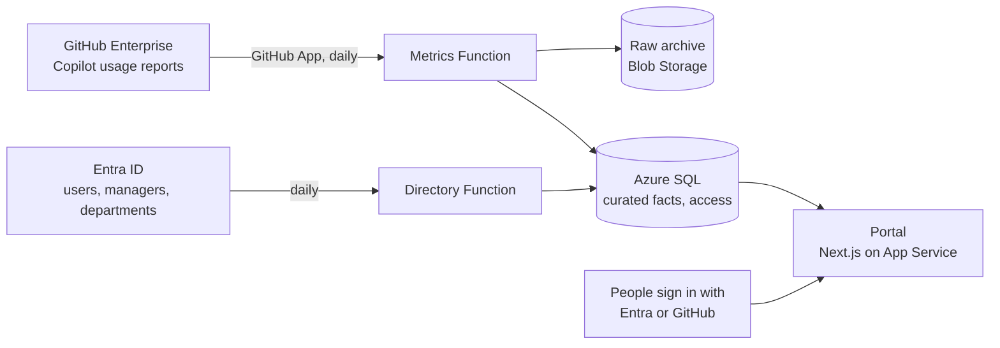
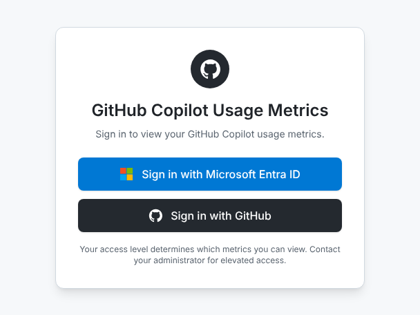
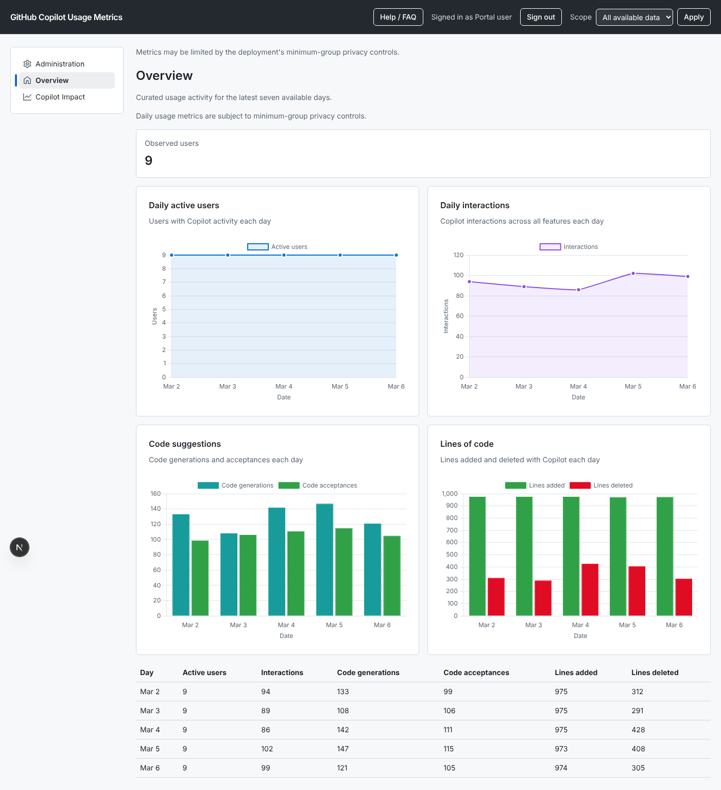
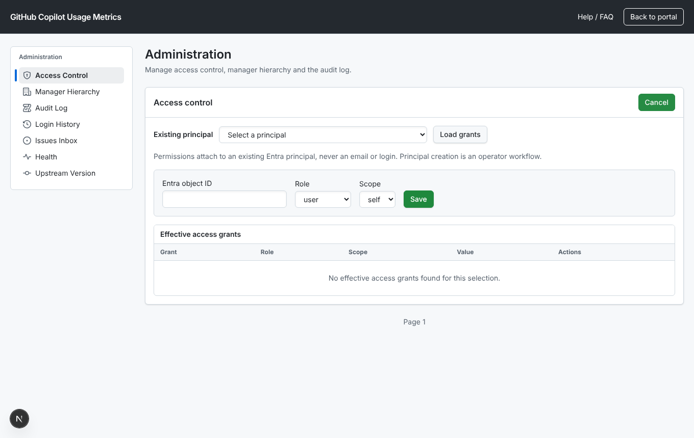
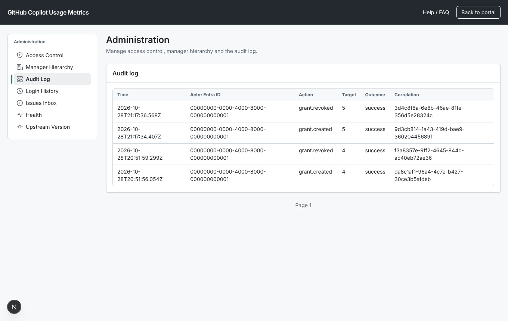

# Copilot Metrics Portal

**See how your company actually uses GitHub Copilot, per team, without handing everyone a spreadsheet of who did what.**

GitHub gives enterprise owners raw Copilot usage reports: one line per user per day. That answers
"how many seats are active", but not the questions leaders and managers ask: Is my department adopting
Copilot? Which editors, languages and models do people use? Is agent mode catching on? Did the rollout
change anything?

This portal turns those reports into a dashboard that each person can open with their company
account. A member sees their own usage, a manager sees their team, an executive sees their department
or business area, and an admin sees the whole company. Small groups are hidden so nobody can single out
an individual. It runs in your own Azure subscription, one deployment per organization, under the MIT
license.

It started as an internal tool and is being reworked so any GitHub Enterprise customer on Azure can
deploy it with one Terraform root and a tfvars file. The dashboards come from the open-source
[copilot-user-level-statistics-viewer](https://github.com/asizikov-demos/copilot-user-level-statistics-viewer),
kept as a pinned, unmodified submodule; this repository adds sign-in, scoped access, storage, ingestion
and infrastructure around it.

**Who it is for:** platform or developer-experience teams that run GitHub Enterprise with Copilot,
use Entra ID, and want to show adoption to leadership and teams without exporting raw data.

## How it works



1. **Metrics sync** (a Function App with a GitHub App identity) downloads the daily Copilot usage
   reports, keeps the raw files in an archive, and loads curated daily facts into SQL.
2. **Directory sync** (a separate Function App) reads users, managers and departments from Entra, so the
   portal knows who reports to whom and which GitHub login belongs to which person.
3. **The portal** signs people in, works out what scopes they are granted, and renders the views for
   those scopes only. Admins manage grants and see the audit trail in the portal.

Everything is created by Terraform in [infra/terraform](infra/terraform/README.md): App Service, two
Function Apps, SQL, Key Vault, Storage, monitoring and alerts. Secrets live only in Key Vault.

## What this adds to the upstream viewer

The upstream viewer is a single-user tool: you load a usage export in your browser and see every
chart for everyone in it. This portal keeps those charts and adds what a company needs to share them.
The screenshots below come from the local stack with synthetic data.

| | |
|---|---|
|  |  |
| **Company sign-in.** People sign in with Entra ID or GitHub instead of uploading a file. | **Scoped dashboards from SQL.** Data comes from the scheduled GitHub sync, not a manual export. The scope picker shows only the scopes a viewer was granted, and small groups are hidden. |
|  |  |
| **Access grants.** Admins grant a role and scope (self, reports, department, business area, company) to an Entra principal. | **Audit and operations.** Every grant change is logged with a correlation ID, next to login history, health and the pinned upstream version. |

## Status: alpha (0.2.x)

The alpha is a restricted private release. It ships:

- **Two dashboards.** Overview and Copilot Impact, rendered on the server as daily aggregate tables for
  the scopes the viewer holds (company, reports, self, or an exact department or business area).
  Groups under 5 users are suppressed. The usage JSON APIs and user-detail routes return 404. See the
  [Safe Alpha runbook](docs/runbooks/safe-alpha.md) for the exact boundary.
- **Access.** Entra and GitHub sign-in, direct grants only (navigation and feature flags never grant
  access), admin access and audit pages, and soft revocation when Entra disables an account.
- **Ingestion.** Metrics sync with optional backfill, and directory sync, both off until you switch them on.
- **Infrastructure.** One Terraform root per environment and Azure DevOps pipelines in
  [pipelines/azure](pipelines/azure).

Not in the alpha yet: per-chart privacy for the extra dashboards (#143), the manager-permission
decision (#67), and the AI Credits and Budget Lookup pages. The Safe Alpha restriction does not
complete the broader #115 reporting scope.

## Switches

A fresh deployment starts with everything that reads data or widens what people see turned off. You
turn each one on in your environment's tfvars when you are ready. Every parameter is also explained in
[terraform.tfvars.example](infra/terraform/stack/terraform.tfvars.example).

**`metrics_sync_enabled`** (default `false`). Turns on the scheduled job that downloads Copilot usage
reports from GitHub and loads them into SQL, on the `metrics_sync_schedule` cron. Without it the portal
has no new data. Turn it on once the GitHub App is installed and its private key is in Key Vault, and
the App-token check (#64) and the restore and SQL permission gates (#55, #56) have passed. Set
`backfill_from` if you also want history.

**`directory_sync_enabled`** (default `false`). Turns on the Function App that copies users, managers
and departments from Entra into SQL, on the `directory_sync_schedule` cron. Manager and department
scopes need it. While off, the app is disabled and its deploy (SCM) site is stopped, so nothing can run
or be deployed to it. Turn it on once `github-directory-pat` holds a real PAT in Key Vault and the
directory SQL user is mapped (#56).

**`modules.upstream_views`** (default `false`). Shows every dashboard from the upstream viewer:
Executive Summary, Languages, Clients, Client Versions, Copilot Adoption, Model Usage, CLI Adoption and
AI Adoption Phases, on top of Overview and Copilot Impact. It uses whole-scope suppression: a scope with
5 or more users shows every chart, including breakdowns of smaller sub-groups. That is looser than the
Safe Alpha rule, so it stays off until the owner accepts it (#115, #143).

**`per_user_detail_enabled`** (default `false`). Lets the portal show GitHub logins and the Users and
User Details pages. While off, every response is aggregate-only, and logins are replaced by
placeholders even when `upstream_views` is on.

**Optional modules** under `modules`. `feedback` adds an in-portal feedback form. `budget_lookup`
(page not released yet) will show live GitHub budgets and needs a billing PAT in Key Vault.
`ai_credits` covers AI Credit reporting (ingestion only in this release). Turning a module on only makes it visible; it never grants
anyone access to data, and it never changes the SQL schema.

## Get started

1. **Try it locally first.** With Docker you can run the portal against synthetic data in a few
   minutes, no Azure or GitHub setup needed. See [Develop locally](#develop-locally) below.
2. **Prepare Azure, Entra and GitHub.** The [prerequisites](docs/setup/prerequisites.md) list the
   app registrations, the GitHub App, the directory PAT and the Azure resources you need.
3. **Fill in the template.** Copy `infra/terraform/stack/terraform.tfvars.example` to
   `terraform.tfvars` in a private deployment repository and replace the placeholders. Keep secrets in
   Key Vault, never in tfvars.
4. **Deploy.** Plan and apply, then create the secrets named in the `secret_names` output. People can
   now sign in; grant the first admins with the
   [access bootstrap runbook](docs/runbooks/entra-access-bootstrap.md).
5. **Switch data on.** Turn on `metrics_sync_enabled` and `directory_sync_enabled`, one at a time,
   after their gates pass. The first dashboards fill in after the next sync.

The [portal FAQ](docs/portal-faq.md) answers what users ask: date ranges, hidden numbers, roles and
privacy. The design and its decisions are in
[docs/architecture/decision-record.md](docs/architecture/decision-record.md); agent rules are in
[.github/copilot-instructions.md](.github/copilot-instructions.md).

## Develop locally

```sh
git clone --recurse-submodules <repo-url>   # or: git submodule update --init
nvm use                                     # Node 22
npm ci
npx playwright install chromium
npm run build && npm run test:e2e           # the same steps CI runs: npm run ci
npm run dev -w portal                       # http://localhost:3000
```

Deployed smoke tests (unauthenticated paths and `/api/health` only): `BASE_URL=https://<environment-url> npm run test:smoke`. With `BASE_URL` set, only `e2e/smoke` runs and no local server is started.

## Local stack

Needs Docker. One command brings up SQL Server 2022 and Azurite (loopback only, throwaway data), applies `db/migrations` through the migration runner and loads the synthetic fixtures from `fixtures/` into the staging tables:

```sh
npm run stack:up      # first start pulls images; SQL Server takes 1-2 minutes on Apple Silicon
npm run stack:down    # stops the containers and deletes their data
npm run db:fixtures   # reload the fixtures into a running stack
npm run db:migrate    # run the migration runner against SQL_CONNECTION_STRING
npm run test:integration   # integration tests against the running stack (not part of `npm test`)
```

SQL Server has no arm64 image, so the stack runs it as `linux/amd64`; Docker Desktop emulates it on Apple Silicon (enable "Use Rosetta" for speed). Defaults: SQL on `127.0.0.1:14330`, database `portal_local`, Azurite on `10000-10002`. Override with `LOCAL_SQL_PORT` and `LOCAL_SQL_SA_PASSWORD`. The fixture loader refuses any non-local host. See [docs/runbooks](docs/runbooks/README.md) for migrations.

`portal/upstream/` is a pinned git submodule and is never edited (D-14). See [docs/architecture/poc-submodule.md](docs/architecture/poc-submodule.md).
