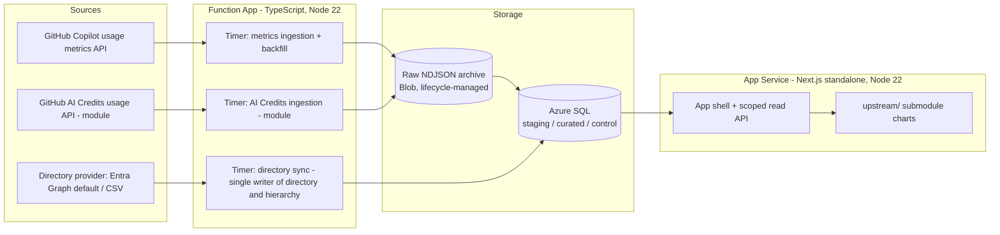
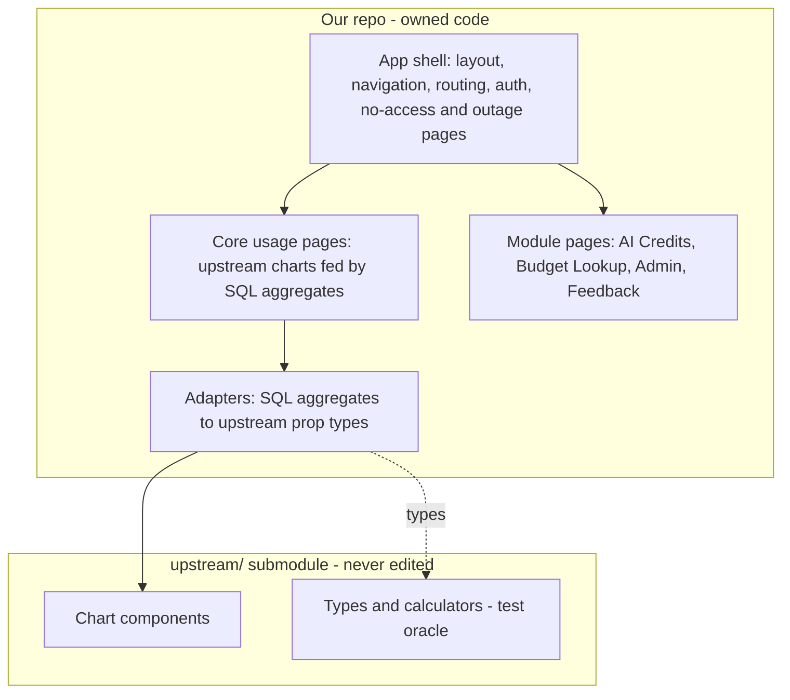
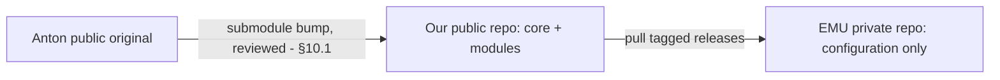

# Copilot Metrics Portal — Architecture Redesign Assessment

**Status:** Final decision record — settled in stakeholder grill sessions (Rounds 1–10, 2026-10-21). Remaining items in §17 are fact checks and late decisions, not open design questions. **This is the sanitized public copy (D-46).** Organization-specific values are replaced by placeholders (`{enterprise}`, `{org}`, `{login-suffix}`, `{group-prefix}`, `{budget-function-app}`); evidence links into the private assessment repository are removed. Statements about "current state" describe the reference deployment the design was derived from.
**Scope:** `copilot-metrics-portal/portal` (customized downstream of the public `copilot-user-level-statistics-viewer` project; upstream is added as a git remote and cherry-picked, not a GitHub fork)
**Verification boundary:** This assessment is based on static inspection of the local working tree only. **No application code, tests, pipelines, or Terraform were changed or run; this Markdown document is the sole workspace artifact.** No `git status`, `git log`, or `git diff` output, and no deployed/production configuration, was available at assessment time. Historical intent (why a file was added, when it diverged from upstream, whether a change was deliberate or incidental) is therefore not inferred.

**Owner revision (2026-10-25, issue #66):** the new solution runs independently in a **separate database from the old solution**. D-29/D-34 and their target-design references below supersede the earlier shared-old-database/shadow-table plan. The old solution remains untouched during parallel operation; data migration happens at the end, and decommissioning follows new-solution acceptance and separate authorization. Historical observations in §2 and the original assessment evidence in §18 are not descriptions of the new runtime.

---

## 1. Executive Summary

This portal is a server-backed Next.js application based on a public statistics viewer, with enterprise authentication, administration, feedback, scoped reporting, and budget lookup. The code shows a mixed data plane: application/control data is in SQL, while Copilot usage metrics and premium-billing files remain in Blob Storage. Metrics are filtered in the server API and then passed as per-user records to a browser worker for aggregation.

The main design concern is not simply that files exist; it is that Blob is still the portal's metrics runtime source, directory data has both SQL and Table Storage representations, schema creation runs at app startup, and enterprise views are wired into upstream-owned frontend code. Documentation also describes an earlier static-site architecture. The current weekly cherry-pick pipeline has bounded commit retrieval and stages conflict markers, so it does not provide reliable semantic compatibility evidence by itself.

**Decided target (see §14 decision record):** a public, MIT-licensed, single-tenant-per-deployment portal composed of a small **core** (Copilot usage analytics, authentication, scoped access, admin, health) plus **optional modules** (AI Credits, Budget Lookup, Feedback) toggled by Terraform flags so that enabling a module needs only a secret and a permission. Ingestion moves from Automation runbooks to **TypeScript timer Functions** that land raw NDJSON in a Blob archive and load **Azure SQL**, the only runtime read store. The API enforces scope and returns aggregates by default. Our public repository consumes Anton's upstream as a **pinned git submodule that is never edited**; our own app shell owns navigation and composes upstream chart components. EMU repositories pull our tagged releases and carry configuration only. The new portal and its TypeScript ingestion use a SQL database separate from the old solution; every table still has exactly one writer (D-29, D-34). The old portal, runbooks and PowerShell Functions keep operating unchanged until a later approved migration/retirement. Billing *automation* (budgets, cost-center mutation, chargeback) and general EMU IAM policy remain out of scope; read-only AI Credits usage ingestion is in scope as a module (deviation V-2, §18.1).

**Evidence labels:** “Verified” means visible in the inspected local source tree. “Recommendation” is a proposed target, not deployed behavior. “Assumption” identifies a planning premise. “Decision required” identifies a stakeholder choice. Historical intent and production configuration remain unverified unless stated otherwise.

**Confirmed premises:** the public repository is a personal open-source contribution maintained by its owner; each deployment serves one organization; Azure and Terraform are required; user-level exposure is configurable with aggregate-only as the default; future API consumers are possible but unconfirmed (APIM deferred). Source/API volumes and RPO/RTO targets are still not supplied (§17).

---

## 2. Current State and Technical Debt

### 2.1 Verified runtime facts

- **Framework:** Next.js 16.2.4, built in `standalone` output mode.
- **Runtime:** Node.js 20.19+ or 22.12+. Node 20 reached end of life in April 2026. The target uses Node 22 LTS as the minimum (end of life April 2027) and moves to Node 24 LTS once both App Service and Functions support it for the chosen plan and region.
- **Auth:** NextAuth v5 (beta) with Microsoft Entra ID and GitHub OAuth providers configured side by side.
- **Session lifetime:** JWT session max age of 8 hours; authorization/permission claims are refreshed on a 15-minute interval independent of the JWT lifetime.
- **Data storage split:**
  - SQL database holds application/control tables (e.g., `AccessControl`, `ManagerHierarchy`, feedback tables, and `CopilotUserDirectory`). The portal creates budget-related DDL, but budget read/write operations are owned by the Function APIs.
  - Azure Blob Storage remains the source for Copilot usage metrics and premium-request billing data — neither was migrated to SQL. In the target, both move to SQL: usage metrics in the core, AI Credits usage as read-only ingestion in the optional AI Credits module (D-8).
  - `CopilotUserDirectory` exists in **both** SQL and Azure Table Storage; hierarchy sync reads the Table Storage copy, while other portal paths read SQL. The workspace shows duplicated representations and access paths; production freshness and canonical ownership are not verified.
  - **Shared database and table owners (verified in the budget Function App's README):** the portal and the PowerShell Function App use the **same SQL database**. The Function App is the write-owner of `CopilotUserDirectory` (`Sync-CopilotUserDirectory-SQL`, daily); the portal backend is the single writer of `ManagerHierarchy`, triggered daily by the Function `Sync-ManagerHierarchy` calling a portal endpoint. `Manage-CostCenter` and `Lookup-BudgetCostCenter` read `CopilotUserDirectory`.
  - **GitHub-to-Entra mapping today:** `Sync-CopilotUserDirectory-SQL` reads Copilot seats and enterprise consumed licenses, then derives a UPN from the EMU login by string rules (strip the `{login-suffix}` suffix, turn single hyphens into dots) and looks the user up in Graph one call at a time. Logins that are hex hashes (`^[0-9a-f]{20,}{login-suffix}$`) cannot be mapped this way.
- **Metrics ingestion (verified in the Automation runbook `Get-UsageMetricsData.ps1`):** an Azure Automation runbook authenticates with a PAT, calls `GET /orgs/{org}/copilot/metrics/reports/users-1-day?day=…`, downloads the report NDJSON files, and writes a **raw** NDJSON copy and an **enhanced** NDJSON copy to the Blob container `usage-metrics-reports`. Nothing is loaded into SQL today; SQL loading is new work in the target design.
- **Billing naming:** "premium requests" ended in June 2026; the current billing unit is **AI Credits**. The UI already labels the view "AI Credits" while code identifiers still use `PremiumBilling`/`premium`.
- **Schema management:** SQL schema DDL (including budget-related tables) is executed from `database.ts` at application startup, i.e., schema migration is coupled to app boot rather than a separate migration step.
- **Metrics API behavior:** The metrics API applies its filtering server-side, then returns per-user records; the client-side hook forwards that payload as NDJSON to a Web Worker for further client-side aggregation/rendering. This is a working but non-obvious two-stage filter/aggregate split (server filters by scope/date, worker aggregates/shapes for charts).
- **Budget ownership:** Budget data and its API surface are owned by the Azure Functions app (`{budget-function-app}`); the portal's SQL layer only creates the budget-related DDL/schema, it does not own budget writes. A separate budget lookup feature exists in the portal UI as a read surface only.
- **Known correctness gaps (as found in code, not yet triaged as bugs vs. accepted limitations):**
  - The screenshot-retrieval GET endpoint validates login state and UUID format for the identifier, but does **not** verify that the parent feedback item is visible/authorized for the requesting user. An authenticated user who obtains a valid screenshot blob name can request it without a parent-item visibility check.
  - The initial admin bootstrap logic grants `company-admin` to users on an environment-variable allow-list **if SQL is unavailable** — a fail-open path tied to an infrastructure outage condition rather than a pure identity check.
  - Blob reads for metrics can treat a timeout as "data missing" and silently skip that day/partition, which can understate usage without surfacing an error to the caller.
- **Placeholder functionality:** `FilterPanel` in the frontend is a stub whose only content is a message stating filters were removed; it is live in the component tree but non-functional.
- **Documentation drift:** `README.md`, `AGENTS.md`, and `docs/project-overview.md` under `portal/` describe an earlier architecture (static export / Table Storage as primary store) that does not reflect the current Next.js standalone + SQL/Blob hybrid. This assessment does not correct those documents (out of scope per task boundary) but flags the drift as debt. *Update 2026-10-21:* `docs/project-overview.md` (which also contained unresolved merge-conflict markers) was deleted and the `AGENTS.md` overview now points to this document.
- **Infrastructure:** There is no portal-specific Terraform. The neighboring automation IaC is a flat, `azurerm`-only IaC project for a separate automation account/function app and is **not** a template to be refactored or reused as-is for the portal; the portal needs its own greenfield IaC state (see §10).

### 2.2 Technical debt summary

| Area | Debt | Risk |
| --- | --- | --- |
| Data model | Metrics and premium-billing files in Blob, directory/control in SQL, directory duplicated in Table Storage | Inconsistent source of truth, double-maintenance of directory data |
| Schema management | DDL executed at app startup from `database.ts` | No migration history/versioning, risk on concurrent instance startup |
| Filtering | `FilterPanel` placeholder vs. working server+worker filter path | Confusing UX, dead code, unclear ownership of filter logic |
| Auth/authz | Screenshot endpoint missing parent-visibility check; fail-open admin bootstrap on SQL outage | Potential authorization bypass; needs security triage, not just documentation |
| Docs | README/AGENTS/project-overview stale | Onboarding and operational confusion |
| Upstream sync | Weekly cherry-pick with conflict markers staged in tree; narrow 20/50-commit window; only portal path checked | Silent drift, large reconciliation batches, unclear chart-level provenance |
| IaC | No portal Terraform; neighboring IaC not reusable | No repeatable deploy, manual/undocumented provisioning assumed |

### 2.3 GitHub API inventory (verified in code and GitHub docs, API version 2026-03-10)

In-scope endpoints, taken from the existing runbooks and Functions. Budget and cost-center endpoints (`/settings/billing/budgets`, `/settings/billing/cost-centers`) are billing automation and out of scope. Today a GitHub App is used only for portal sign-in (OAuth); every API call above uses a PAT.

| Purpose | Endpoint | Used today in | Token support (docs) |
| --- | --- | --- | --- |
| Usage metrics (core) | `GET /orgs/{org}/copilot/metrics/reports/users-1-day?day=` | `Get-UsageMetricsData.ps1`, `Invoke-HistoricalBackfill.ps1` | Classic PAT `read:org`; fine-grained "View Organization Copilot Metrics". Data from 2025-10-10, **last 365 days only** (confirmed by owner) |
| AI Credits (module) | `POST /enterprises/{ent}/settings/billing/reports`, `GET .../reports/{id}`, then download URLs | `Get-CopilotPremiumBillingData*.ps1` | **GitHub App installation token** with enterprise billing read is supported; classic PAT also works. Up to 24 months of data. `report_type` now offers `ai_credit`; the runbook still requests `premium_request` |
| Copilot seat holders (directory) | `GET /orgs/{org}/copilot/billing/seats` | `Sync-CopilotUserDirectory-SQL` | Classic PAT `manage_billing:copilot` or `read:org`. Returns numeric GitHub user ID and login |
| License type (directory) | `GET /enterprises/{ent}/consumed-licenses` | `Sync-CopilotUserDirectory-SQL` | **Classic PAT only** (`read:enterprise`); no fine-grained or App support. **Dropped in the target (D-38)**: only `license_type` remained unique to it |
| GitHub-to-Entra identity (directory) | `GET /scim/v2/enterprises/{ent}/Users` | Not used today | **Classic PAT only** (`admin:enterprise` for reads by an enterprise owner). `externalId` = Entra object ID (documented for Entra SAML). Returns `userName` (UPN), `emails`, `active`, SCIM `groups` (for example `{group-prefix}.{BA}.RestrictedUser`), and in practice `profileUrl` (`https://github.com/{login}`); no numeric GitHub user ID |

---

## 3. Customization Inventory

Classification key: **Keep** (enterprise-essential, retain as-is or with minor hardening) · **Remove** (dead/placeholder, delete) · **Replace** (functionally superseded by target architecture) · **Refactor** (valuable but needs structural rework) · **Optional** (nice-to-have, defer to stakeholder call).

| Customization | Classification | Rationale |
| --- | --- | --- |
| Entra ID + GitHub dual OAuth (NextAuth 5) | Keep, refactor | Both providers stay (D-5); permissions attach to one internal principal keyed on immutable IDs, never on email or provider (§13.1) |
| SQL app/control tables (budget DDL, directory) | Refactor | New solution uses a separate database, `portal` schema and versioned migrations; one writer per table; no budget DDL or old-database changes (D-34) |
| Portal hierarchy-sync read from `CopilotUserDirectory` in Azure Table Storage | Replace | TypeScript directory sync builds the new database's directory/hierarchy through the ingestion component; the old directory, Table Storage and PowerShell Functions stay untouched during independent parallel operation (D-29) |
| Metrics NDJSON → Web Worker aggregation pipeline | Replace | Aggregates are computed in SQL and served by the API (D-15); upstream's aggregation code is reused only as a test oracle |
| Budget lookup API/ownership (Functions-owned) | Keep (as portal feature) | Portal should remain a read-only consumer of Functions-owned budget data; do not pull budget write/automation logic into the portal |
| Business-area / scope selector | Keep | Enterprise scoping requirement, appears load-bearing for multi-business-unit views |
| Business-area billing report, billing charts (Business Area, Cost Trend, Model Cost, Top Users, User Cost) | Keep, move into AI Credits module | Become owned pages of the optional AI Credits module backed by read-only SQL usage data (D-1, D-8) |
| Separate "budget lookup" feature (distinct from billing reports) | Keep (portal feature only) | Explicitly scoped as a portal UI feature; not a billing-automation concern |
| `FilterPanel` placeholder | Remove | Confirmed non-functional stub; superseded by server+worker filter path |
| Initial admin env-var allow-list w/ SQL-unavailable fallback | Refactor | Security-relevant fail-open behavior; needs a hardened bootstrap design, not deletion, since some bootstrap mechanism is still required |
| Screenshot GET endpoint authorization | Refactor | Needs parent-feedback-item visibility check added; functionally keep the endpoint |
| Stale README/AGENTS/project-overview content | Refactor (separate doc task) | Out of scope for this document's edits, but flagged for a follow-up docs-only change |
| Upstream sync pipeline (weekly, cherry-pick, 20/50 SHA window) | Replace | Replaced by a pinned git submodule bumped by Dependabot PRs (D-14, §10.1) |
| Neighboring flat `azurerm` IAC reuse for portal | Remove (as a template) | Confirmed separate concern for a different automation account; do not couple portal IaC to it |

### 3.1 Enterprise feature and dashboard inventory

The local portal navigation and component tree verify these enterprise-facing areas. Classification applies to the recommended architectural direction; it does not claim historical authorship when a Git diff is unavailable.

| Feature area | Verified current behavior | Classification |
| --- | --- | --- |
| Authentication and authorization | Entra ID and GitHub OAuth; role/scope resolution and scoped metrics/billing routes | **Keep, refactor** identity mapping, permission freshness, fail-closed behavior, and service boundaries |
| Administration | Access grants, hierarchy management/sync, audit view, upstream-sync status | **Keep, refactor** into an enterprise admin module with versioned APIs |
| Feedback | Submit/list/vote/comments, screenshot storage, webhook and work-item adapters | **Keep, refactor** visibility enforcement and optional integrations |
| Budget Lookup | Read-only user, manager, and cost-center lookup through Functions | **Keep optional/configurable** as a portal adapter; no budget automation redesign |
| Business-area/department scopes | Selector and scope-aware metrics/billing views | **Keep, refactor** into shared authorization/data-provider contracts |
| AI Credits view (code: `PremiumBillingView`) | Separate dashboard and billing-specific charts backed by Blob data | **Keep as the optional AI Credits module** with read-only usage ingestion into SQL (D-8). Budget/cost-center automation remains out of scope |
| AI Adoption Phases and enterprise navigation | Present in local navigation/router | **Keep, configurable** pending metric definitions and desired upstream parity |
| FilterPanel | Placeholder explicitly reports no active filters; other scope/date controls exist elsewhere | **Remove placeholder** after checking dependents; do not remove working scope/date behavior |
| Local-only non-billing charts | Listed in §4.1 | **Keep or make configurable** after owners confirm purpose; no historical removal claim |
| Upstream-only charts | Listed in §4.2 | **Optional restore/review** based on capability and product requirements; absence locally does not prove intentional removal |
| FeatureAdoptionChart categories | Local version lacks upstream's VS Code Agents and Copilot App categories (§4.3) | **Adopt upstream's chart as-is** (D-22); the local copy is retired |
| Upstream synchronization/status surface | Weekly pipeline and portal admin status view | **Replace** with submodule pin; admin status shows the pinned upstream commit and release version |

---

## 4. Chart Snapshot Comparison

This is a **file-tree snapshot comparison only**, taken from the current local working trees of the portal and the public upstream project. It is **not** a historical diff and does **not** establish *when* or *why* any chart was added, removed, or renamed on either side.

> **Caveat:** Determining true historical intent (e.g., "this chart was deliberately added for enterprise use" vs. "upstream renamed/replaced a chart and the fork never picked up the removal") requires either a merge-base comparison between the fork and upstream histories, or the sync pipeline's recorded `lastSyncedSha`/commit-window state. Neither was available during this assessment. All statements below describe **current file presence**, not intent.

**Snapshot counts:** portal has 31 chart files, upstream has 20 chart files, 14 are same-named on both sides.

### 4.1 Portal-only chart components (17)

> **Update (2026-10-25, issue #84):** upstream at `00608a2` now ships 11 of these 17; only `AgentModeHeatmapChart` and the five `Billing*` charts remain portal-only. Owner decisions are in `feature-parity.md`.

`AdoptionTrendChart`, `AgentModeHeatmapChart`, `BillingBusinessAreaChart`, `BillingCostTrendChart`, `BillingModelCostChart`, `BillingTopUsersChart`, `BillingUserCostChart`, `ClientActivityChart`, `CloudAgentAdoptionChart`, `CloudAgentsUsageChart`, `CodeReviewAdoptionChart`, `DayClientDistributionChart`, `FeatureAdoptionRadarChart`, `LanguageDailyChart`, `UserActivityByLanguageAndFeatureChart`, `UserActivityByModelAndFeatureChart`, `UserSummaryChart`

Note: the presence of billing-prefixed charts here is consistent with the portal's enterprise billing-reporting scope described in §3, but this section records file presence only — it does not assert that every portal-only chart is an intentional enterprise addition versus, e.g., a local rename of something upstream later changed too.

### 4.2 Upstream-only chart components (6)

`AgentActivityChart`, `AiCreditsChart`, `DailyIDEUsersChart`, `ModelCategoryDistributionChart`, `ModelVendorDistributionChart`, `VSCodeAgentUsageChart`

These exist upstream but have no same-named counterpart in the portal tree today. Whether they were never synced, synced then removed, or renamed on the fork side cannot be determined without merge-base data.

### 4.3 Same-name components with diverging content (1 confirmed)

`FeatureAdoptionChart` exists on both sides under the same file name. A line-by-line check (2026-10-21) corrects an earlier draft of this section: the versions do **not** use rival categories. Upstream is a superset.

| Category | Portal | Upstream |
| --- | --- | --- |
| Completion, Chat, IDE Agent Mode, Copilot CLI, Cloud Agent, Code Review | Yes | Yes |
| VS Code Agents | No | Yes |
| Copilot App | No | Yes |
| "Advanced Users" definition | IDE Agent + CLI + Cloud Agent | IDE Agent + VS Code Agents + CLI + Cloud Agent |

The portal is behind upstream (sync has not been pulled for a while). Decision D-22 adopts upstream's chart with its calculator and types; the "Advanced Users" figure will rise because its definition widens. Only this one of the 14 same-name charts was compared line by line; the other 13 were not.

### 4.4 Recommendation for chart-level provenance

Before making any Keep/Remove decisions on individual charts, obtain one of:

1. A merge-base commit between the fork's current `HEAD` and upstream, to diff chart directories at the point of divergence, or
2. The sync pipeline's `lastSyncedSha` (if persisted anywhere in pipeline state/artifacts), to replay upstream's chart-directory history from that point forward.

Without one of these, any chart deletion should be treated as a **UX/product decision validated with stakeholders**, not an automated "upstream doesn't have it" cleanup.

### 4.5 Chart-difference classification

| Current-tree difference | Classification | Rationale |
| --- | --- | --- |
| Five `Billing*` portal-only charts | **Move into the AI Credits module** | Billing automation is out of scope; read-only ingestion is part of the AI Credits module (D-8). |
| Other portal-only charts in §4.1 | **Keep or make optional pending product-owner review** | Local presence is verified, but historical intent and user value are not. |
| Six upstream-only charts in §4.2 | **Optional restore/review** | Upstream currently has them, but local absence may reflect a rename, intentional removal, or unsynced drift. |
| Divergent `FeatureAdoptionChart` | **Adopt upstream** (D-22) | Upstream is a superset; tell stakeholders the Advanced Users number changes. |

---

## 5. Target Architecture (High Level)

Principles:

- **Azure SQL is the only runtime read store** (D-11). The portal never reads Blob or calls GitHub/Graph per request.
- **Raw NDJSON is archived in Blob** with a lifecycle policy so data can be replayed when parsers or definitions change (D-11). The current "enhanced" NDJSON is dropped; SQL replaces it.
- **Ingestion, validation, typed staging, and idempotent transform** are explicit stages; re-running a day replaces that day and never duplicates it (D-28).
- **The API returns aggregates by default**; per-user detail is a deployment setting.
- **Modules are toggled by Terraform flags**; flags never grant access (§12.5).

---

## 6. SQL Data Model: Raw / Staging / Curated / Control

| Layer | Purpose | Characteristics | Example tables (indicative, not final DDL) |
| --- | --- | --- | --- |
| **Raw (Blob archive)** | Replayable landing zone for raw NDJSON (D-11) | Immutable objects with source, organization, report day, ingestion ID, schema version, and content hash; lifecycle-managed | `raw/{source}/{org}/{yyyy}/{mm}/{dd}/...` |
| **Staging** | Typed, validated records before deduplication/conformance | Preserve source keys and run ID; route invalid rows to quarantine with reason and raw-object reference | `stg_user_daily_metrics`, `stg_metric_breakdown` |
| **Curated** | Query-optimized metrics facts and dimensions read by the portal | Stable user key, explicit metric definition/version, current organization attributes (D-16), indexed by organization/date/user | `fact_user_daily_usage`, `fact_usage_breakdown`, `dim_user`, `dim_feature`, `dim_model`, `dim_client`, `dim_language`, `dim_date` |
| **Control** | Ingestion, lineage, authorization, and operational metadata | Run status, source cursor/checkpoint, validation issues, transformation version, audit and directory/hierarchy state | `IngestionRun`, `SourceCheckpoint`, `SourceArtifact`, `ValidationIssue`, `TransformVersion`, `DirectorySyncState`, `PrincipalLinkState`, `AuditLog` |

### 6.1 Data architecture alternatives

| Option | Advantages | Disadvantages | Complexity and long-term maintenance |
| --- | --- | --- | --- |
| Retain Blob as runtime source and SQL as control plane | Lowest immediate migration cost; raw files are already available | Repeated file reads/parsing, implicit completeness, coarse query efficiency, directory duplication, and application-layer aggregation remain | Low initial complexity; high ongoing operational and correctness burden as data volume and report requirements grow |
| SQL-only, with no raw archive | One runtime store and straightforward query ownership | Loses convenient exact-source replay; schema/API changes can make historical reconstruction difficult | Medium migration complexity; potentially higher SQL storage/compute cost and less recovery flexibility |
| SQL curated model plus raw Blob archive (**decided**, D-11) | Separates replay from query serving; gives typed, indexed, scoped reads and traceable transformations | Requires ingestion, schema versioning, and retention rules | Highest initial design/migration complexity; lower long-term query and troubleshooting burden if contracts and ownership stay explicit |

### 6.2 Ingestion operations (per run)

1. **Extract incrementally** from the Copilot metrics API/export using a persisted cursor or bounded overlap window. Record source organization, requested period, API/schema version, and upstream report identity.
2. **Land and fingerprint** the original payload in the raw archive. Store an immutable object reference and SHA-256 content hash in `SourceArtifact`; CSV/NDJSON is an ingestion boundary, not a portal runtime interface.
3. **Validate** required fields, types, dates, supported schema version, row identity, and expected date coverage. Preserve unknown fields in raw; quarantine invalid records with machine-readable error codes rather than silently dropping them.
4. **Stage** typed rows with run IDs and source keys. Record row counts and validation results before advancing the source checkpoint.
5. **Deduplicate and transform idempotently.** Use a stable source key where available; otherwise derive a documented key from organization, stable GitHub user ID, report date, metric family, and source revision/hash. Upsert in a transaction and make replay of the same input produce the same curated state.
6. **Retry safely.** Retry transient HTTP/SQL failures with bounded exponential backoff and jitter. Persist failed-run state and retry count; quarantine poison records; do not advance the checkpoint when a batch is incomplete. A timeout is not equivalent to an empty report.
7. **Reconcile completeness.** Compare requested dates, source row counts, staged/curated counts, and any source-provided totals. Mark periods complete only after checks pass; alert on gaps, duplicate surges, schema drift, or repeated retries.
8. **Record lineage.** Link each curated row or load batch to `IngestionRun`, `SourceArtifact`, transform version, code/release SHA, and source schema/API version. Scope uses the current hierarchy only (D-16).
9. **Guard day replacement.** A re-run replaces a day only if the new data passes validation and does not have fewer rows than the stored day. A day replaced by less data is blocked and quarantined; only an admin force flag, recorded in the audit log, lets it through, and forcing an empty (0-row) day needs an additional typed confirmation of the date. Duplicate user keys or duplicate nested names quarantine the whole file with a machine-readable code (`duplicate_file`, `duplicate_nested_name`) and surface in the Admin issues inbox (backed by `ValidationIssue`, a fixed action set per issue type, every action audited, banner count only; email or Azure Monitor alerts later, issue #37). Timer runs, backfill, and the importer take a per-day SQL application lock (`sp_getapplock`) so they never overlap on the same day.
10. **Serve** purpose-built, authorized queries through the portal API; do not require the browser to download company-wide per-user records to calculate common aggregates.

### 6.3 Performance, monitoring, and retention

- Index curated facts for the observed query shape: organization + date range + stable user key; add dimension indexes for scope resolution. Add date partitioning or summary tables only after representative row counts, query plans, and concurrency tests show a benefit.
- Bound date ranges and page sizes; precompute expensive repeated aggregates where measurements justify it. Benchmark SQL tier, cold-start latency, API p95, and concurrent portal sessions before selecting capacity.
- Emit correlated ingestion and API telemetry: run/source IDs, freshness, duration, retry count, row counts, quarantine counts, missing periods, SQL wait/CPU, and API errors. Alert on freshness SLO breaches, incomplete periods, schema changes, and repeated failures.
- Make raw, staging, curated, and audit retention explicit per deployment. Use storage lifecycle/immutability only where the chosen retention and replay requirements support it. Define deletion handling for user identity mappings and derived facts before production rollout.
- Use stable GitHub user IDs as fact keys where available; treat login/email as mutable attributes. Department, business area, and manager are current values only (D-16).
- **Minimum group size:** aggregate responses for any group smaller than a configurable threshold (default 5) are suppressed, so aggregate-only mode cannot reveal an individual through a tiny team.
- Usage API periods are fixed (7, 28, or 90 days, or a complete calendar month) to limit subtraction attacks on arbitrary overlapping ranges. Nested rolling periods still overlap; the accepted trade-off and rationale are documented in the [portal FAQ](../portal-faq.md). Per-user detail remains separately controlled by `PER_USER_DETAIL_ENABLED`.

### 6.4 Decided parameters

| Parameter | Decision | Configurable |
| --- | --- | --- |
| Raw archive | Keep raw NDJSON in Blob, immutable; move to Cool after a configurable age (default 13 months) and retain without deletion (D-11). Separate from SQL retention (D-12) | Yes |
| Per-user daily rows in SQL | 13 months default, maximum 36 (D-12) | Yes |
| `dim_user_login_history` | Kept for audit and purged after a maximum age: default 24 months, maximum 60; admin read only. Explicit exception to the per-user rule above (D-12) | Yes |
| Aggregates in SQL | Kept indefinitely (D-12) | Yes |
| Team scope | Direct and indirect reports from the **current** hierarchy; no effective-dated history (D-16). Dated history is a possible later module | No |
| Directory source | Pluggable provider: Entra Graph (default, bulk user and manager reads) or CSV import (D-4). In EMU, SCIM supplies identity (D-36); department and business area come from configurable Entra attributes (D-5) | Yes |
| Backfill | `backfill_from` date; ingestion pulls older days from the API, limited to the last 365 days (API starts 2025-10-10) (D-23, D-28) | Yes |
| Existing files | One-off importer copies existing **raw** NDJSON into the archive layout; normal replay loads it. Enhanced files are ignored (D-28) | — |

Effective-dated organizational attributes are not modelled (D-16); facts record the organization values seen at load time for audit only.

### 6.5 Independent database and table ownership (D-29, D-34)

The new solution uses a **database separate from the old solution**. The old portal, directory/hierarchy sync, budget Functions and their database keep running unchanged. Separation is at the database boundary; a separate logical SQL server is not required. Terraform may create the new database or reference separately provisioned new SQL resources with `existing`; `existing` must not mean the old solution's database.

Within the new solution, **every table has exactly one writer**. The logical `ingestion` component is the sole writer of `portal.dim_user` and `portal.dim_user_login_history`; metrics and directory paths use that component, not independent database writers. Directory sync owns directory attributes and current hierarchy/link/revocation state through ingestion. Runtime identity isolation and Graph consent remain the separate #67 decision; the table-writer name does not settle that credential boundary.

| New database tables | Writer | Readers / purpose |
| --- | --- | --- |
| `portal.dim_user`, `portal.dim_user_login_history` | `ingestion` | Scoped portal reads; login history admin-only (D-12) |
| Other ingestion-owned dimensions/facts, staging, lineage and validation tables | `ingestion` (except migration-seeded `dim_date`) | Portal reporting/operations under existing grants |
| `portal.DirectorySyncState`, `portal.PrincipalLinkState`, `portal.GrantRevocation` | Directory sync through `ingestion` | Freshness and fail-closed grant/link resolution; no success state for partial runs |
| `portal.Principal`, `portal.PrincipalIdentity`, `portal.AccessGrant`, feedback tables | Portal | Portal under existing authorization |
| `portal.AuditLog` | Portal (append-only) | Portal admin |
| `portal.IngestionAuditEvent` | `ingestion` (append-only) | Portal admin; action-specific operational metadata only |

- Reuse the existing numeric-ID `dim_user`, manager Entra ID/recognition email, directory attributes and sync-state contracts. #69 inventories and defines only missing contracts; #70 supplies only justified persistence deltas. Do not copy old email/login-keyed tables or create v1-compatible shadows merely for old consumers. Existing v1/v2 descriptors in `shared/` remain historical/external-integration references, not the new runtime schema.
- Do not create/alter old `dbo` directory, hierarchy, audit, budget or cost-center tables, or create budget DDL in the new database. No runtime cross-database comparison reader/identity is required. Reconciliation still requires authorized evidence, coverage and no unexplained differences (#79/#80); missing evidence is not a pass.
- Stable numeric GitHub IDs, immutable principal Entra columns, the existing tenant-FK arrangement, single-writer access/grant boundaries, privacy and fail-closed authorization remain unchanged. `github_license_type` stays nullable/unsourced wherever retained; `consumed-licenses` stays excluded (D-38).
- **Budget Lookup remains an optional read-only module (D-1).** Its previously assumed shared-`dbo` source/access contract is unresolved under database separation. Decide the module's approved read source/access before implementation; do not assume access to the old database, introduce per-request external calls, or remove the module. #43 is a deferred external Budget Functions integration decision, not a prerequisite for independent Phase 2 directory operation.
- Final migration/source access and cutover need a separately approved plan (§15.1). #55/#56, restore/rollback, the `20261026001200` maintenance window and acceptance evidence remain gates; database separation authorizes none of those operations.

---

## 7. Implementation Language Comparison (PowerShell / C# / Python)

| Dimension | PowerShell | C# | Python |
| --- | --- | --- | --- |
| Current footprint | Existing Functions and automation glue; PowerShell 7.x/Pester conventions are present in neighboring repos | No current implementation in this portal scope | No current implementation in this portal scope |
| Advantages | Low switching cost for timers, REST/Graph calls, and operational orchestration | Strong static typing, mature SQL/Azure SDKs, robust transaction/API patterns, good fit for durable services | Strong data/ETL ecosystem and approachable scripting for analytics transformations |
| Disadvantages | Less ergonomic for a long-lived, broad HTTP API; dynamic typing can make large domain contracts harder to maintain | Adds a runtime and contributor skill requirement; rewrite is not justified without a service ownership need | Adds a runtime and dependency surface; dataframe tooling is unnecessary for ordinary typed ingestion and SQL aggregation |
| Performance and scale | Adequate for moderate scheduled orchestration; not the reason to select it for a high-concurrency query API | Good throughput and predictable resource use for API/SQL workloads | Good for batch/ETL; performance depends on workload and should be benchmarked, not assumed superior |
| Azure integration | Strong Functions, Graph, and Az modules; existing managed-identity patterns | Strong Azure SDK, Functions, SQL, and identity support | Azure SDK and Functions support; package/runtime versions need disciplined pinning |
| Contributor and testing experience | Familiar to current operators; Pester/PSScriptAnalyzer are appropriate, but contributor pool is narrower for app APIs | Strong unit/integration test tooling and compile-time feedback; requires .NET toolchain familiarity | Accessible to analytics contributors; type checks and dependency lock discipline are important for reliability |
| Complexity and long-term maintenance | Low incremental cost when kept to thin existing orchestration; rises sharply if it becomes the whole product API | Medium initial cost; can lower API/domain maintenance if one team owns it and contracts are stable | Medium initial cost; additional language is only worthwhile if it removes real transformation complexity |
| Suitability (original comparison, superseded by §7.1) | **Retain for existing thin ingestion orchestration.** Do not rewrite working scripts solely for consistency. | **Preferred for a new standalone typed API**, conditional on committed maintainer ownership. Keep the current Next.js BFF until that need exists. | **Use only where measured analytics/ETL value justifies the extra runtime.** |

### 7.1 Decision: TypeScript end to end (D-6, deviation V-1 in §18.1)

The original brief offered C#, Python, or PowerShell. The decision is **TypeScript** for the portal, API, and ingestion Functions, because one language across UI, API contracts, and ingestion is the simplest to maintain and the most open to contributors. TypeScript on Azure Functions is production-ready: the Node.js v4 programming model is GA (timer, queue, HTTP, Durable Functions), `@azure/identity` provides managed identity, and `mssql` supports Entra tokens. C# is the fallback only if a proof-of-concept shows a blocking gap.

The new solution uses TypeScript timer Functions for metrics and directory/hierarchy sync (D-10, D-29). During parallel operation the old metrics runbooks, `Sync-CopilotUserDirectory-SQL`, `Sync-ManagerHierarchy` and old portal remain unchanged against their own stores. Final data migration happens at the end; retirement requires new-solution acceptance and separate authorization. Budget and cost-center automation remains out of scope and stays PowerShell; this design does not authorize changing or retiring its dependencies.

---

## 8. Hosting Model Comparison: Functions / API / APIM / Hybrid

The options below compare the requested deployment topologies. API Management is a gateway and policy layer; it does not replace the backend API implementation.

### Option A — Azure Functions for ingestion and portal queries

**Components and responsibilities:** timer/HTTP-triggered Functions extract and validate GitHub data, transform/load SQL, and expose query/admin endpoints. Use Durable Functions only for multi-step, long-running work that needs checkpoints, retries, or orchestration.

**Advantages:** one compute platform, event-driven scaling, low idle cost on consumption-style plans, and a natural home for scheduled ingestion.

**Disadvantages:** interactive query APIs inherit Functions hosting/runtime conventions; cold starts and scale behavior require plan-aware design; mixing high-frequency reads with batch ingestion couples scaling and operational tuning.

**Cost, complexity, and maintenance:** low-to-medium initial complexity and potentially low cost at intermittent load. Durable orchestration adds storage and operational concepts; always-warm/premium capacity raises predictable cost.

**Security and scalability:** validate Entra tokens and enforce record-level scope in the function/service; a Function key is not end-user authorization. Ingestion scales independently by trigger only when separated into appropriate apps/plans; SQL may become the limiting shared dependency.

**Best fit:** scheduled ingestion, backfill, and low-volume APIs with one consumer and acceptable cold-start behavior.

### Option B — Dedicated backend API exposed through APIM

**Components and responsibilities:** a dedicated App Service or Container Apps API owns versioned query/admin contracts and SQL access. APIM fronts it for routing, JWT policy enforcement, rate limits/quotas, versioning, and API observability. Functions may still be retained for scheduled ingestion, but are not the portal query surface in this option.

**Advantages:** clear API boundary, independent deployment/scaling from the frontend, and a governed interface for multiple clients.

**Disadvantages:** more services, networking, deployment stages, and ownership. APIM is an additional gateway hop and can be disproportionate when the portal is the only consumer.

**Cost, complexity, and maintenance:** highest of the options; APIM SKU, network integration, API policy, and the dedicated service all add recurring cost and support responsibility.

**Security and scalability:** APIM can validate tokens and apply coarse gateway policies, but the backend must still enforce user/team/business-area data scope. API and gateway can scale separately; SQL query design and connection limits remain critical.

**Best fit:** multiple independent API consumers, formal API lifecycle/governance needs, or a requirement for centralized throttling and API products.

### Option C — Hybrid Functions ingestion plus dedicated/portal API (**recommended target**)

**Components and responsibilities:** Functions own ingestion, scheduled processing, and durable orchestration where required. SQL is the curated read model. The existing Next.js BFF initially serves the portal; it can be replaced by a dedicated API when consumers or ownership needs justify it. APIM remains an optional edge component.

**Advantages:** separates batch and interactive workloads, allows a low-friction first migration, and provides a clear path to an independently deployed API without forcing APIM on day one.

**Disadvantages:** multiple deployables and contracts require versioned schemas, correlation IDs, integration tests, and clear ownership. Teams must avoid implementing authorization inconsistently in the BFF, Functions, and future API.

**Cost, complexity, and maintenance:** medium initial complexity; higher than Functions-only but lower than provisioning APIM immediately. Long-term maintenance is moderate if Functions and API have explicit ownership and shared contracts.

**Security and scalability:** use managed identity service-to-service access and one documented authorization policy; the API scopes every query and returns aggregate DTOs by default. Ingestion and reads can scale independently, subject to SQL capacity.

**Recommendation:** adopt the hybrid logical design. Keep the Next.js BFF as the first read API because it is the portal's current server boundary; add a dedicated API only when a second real consumer or a scaling/ownership requirement appears. Add APIM only when gateway governance, multi-consumer policy, or rate limiting warrants its cost.

**Decided (D-18):** the portal runs on **App Service Linux, Node 22**, as today (no container registry). Ingestion runs in a **separate TypeScript Function App**. APIM is deferred.

---

## 9. Frontend Extension Boundaries

The current upstream is a client-side file viewer; enterprise authentication, server APIs, SQL access, and app hosting are architectural additions. The decided structure (D-14, D-15) is **our app shell around an unmodified upstream**:

- **Verified feasibility:** upstream chart components take data through props and import only upstream types, formatters, chart utilities, calculators, and local presentational hooks (for example `useExpandableList` via `ClientTelemetryNotice`). None use React context or upstream app state. They can be imported without modification.
- **Adopting a chart means adopting its calculator and types.** For example, upstream's `FeatureAdoptionChart` needs `vscodeAgentUsers` and `appUsers`, so the adapter and SQL model must supply them.
- **Navigation and routing are ours**, not upstream's `ViewRouter.tsx`. Our pages (modules, admin) sit beside upstream charts, not inside upstream code.
- **Adapters** map SQL aggregates to upstream prop types. A type change upstream fails compilation in the bump PR, which is the intended detection point.
- **Test oracle (D-15):** upstream's aggregation code runs on fixture NDJSON in CI; our SQL aggregates must match. Each upstream bump therefore detects metric-definition changes automatically.
- **Trade-off:** new upstream charts do not appear automatically. On each bump the agent compares upstream's chart directory between the old and new commits and opens a PR proposing navigation wiring; a human decides.
- **Portal-only charts** (§4.1) become owned pages; the AI Credits charts move into the AI Credits module.
- Feature flags control module visibility only; they never grant access.

---

## 10. Customized Fork vs. Separate Public Downstream Repository

| Option | Repository/sync model | Advantages | Disadvantages | Complexity and long-term maintenance |
| --- | --- | --- | --- | --- |
| **A. Customized fork** | Preserve upstream ancestry; merge upstream main/release tags into a tracking branch and open PRs into the enterprise branch. Isolate enterprise packages/configuration; retain only a small adapter seam in shared files. | Native Git history and merge-base comparisons; easy upstream contributions; one repository and familiar workflow. | Enterprise still carries server/auth/data API changes upstream may not accept; shared entry points and chart taxonomies remain conflict hotspots. | Medium initial effort; medium-high ongoing maintenance until upstream accepts extension points. Tag releases with the exact upstream SHA and enterprise version. |
| **B. Separate public downstream with automated sync** | Keep the original public repo as a read-only remote and track its exact SHA in a dedicated upstream branch or vendored subtree. Keep enterprise shell/features in separate packages/directories. Automation fetches upstream, opens a reviewed sync PR, runs compatibility/golden tests, and reports conflicts without committing markers. | Clear ownership boundary; enterprise modules remain isolated; supports a public personal contribution; sync policy can be validated before promotion. | Upstream has no stable plugin/package contract, so the integration adapter and source layout must be maintained; path mapping and release discipline are required. | Medium-high initial restructuring; medium ongoing effort if sync remains incremental and automated. Release notes pin upstream SHA plus downstream semver; rollback reverts a sync PR or restores the prior release tag. |

**Decision (D-7, D-14):** Option B. Our public repository is its own repository (not a GitHub fork) and consumes upstream as a **git submodule** pinned to a commit. The submodule was not in the original draft, which named "a dedicated upstream branch or vendored subtree"; it is a pinning mechanism within Option B, chosen because it makes local edits to upstream code impossible and lets Dependabot open bump PRs. Upstream's licence and copyright notice are preserved (D-25). No feature parity with upstream is promised; generic fixes are contributed upstream where possible.

A successful lint/build is not enough to prove semantic compatibility. Each bump must pass the contract and test-oracle checks in §9.

### 10.1 Submodule rules and agent-reviewed sync

| Topic | Rule |
| --- | --- |
| Location | `portal/upstream/` (inside the app so module resolution reaches our `node_modules`) |
| Edits | **None.** CI fails any PR that changes files inside the submodule other than the pinned commit |
| Bumps | Dependabot `gitsubmodule` ecosystem, weekly |
| Checks | Build, type check, contract tests, test oracle (§9), authorization tests |
| Agent | On failure or a metric-definition change, a workflow assigns the Copilot coding agent on github.com (assignment is not native to labels; whether the agent can push to Dependabot branches is verified in the proof of concept, otherwise it opens a follow-up PR). Repository instructions restrict it to adapters, our pages, and `package.json`; it never edits the submodule |
| New upstream charts | Agent opens a separate PR proposing navigation wiring |
| Merge | A human approves every PR (CODEOWNERS + branch protection, D-25); agents and Dependabot cannot merge |
| Release | Release notes record the pinned upstream commit (D-21) |

**Proof of concept before adoption** (any failure triggers the fallback):

1. The Copilot coding agent's environment checks out the submodule (`git submodule update --init` in `copilot-setup-steps.yml`).
2. Next.js 16 with Turbopack builds and traces source outside the app root (`turbopack.root` / `outputFileTracingRoot`).
3. Upstream's path alias, if any, does not clash with ours.
4. EMU CI can fetch from public `github.com`.

**Fallback:** `git subtree --squash` into the same path plus the same CI check blocking edits under it. Bump PRs then come from a scheduled workflow instead of Dependabot.

---

## 11. Narrow EMU Sync Design

This section covers only how an EMU (private) repository receives updates. It is not an EMU IAM/governance document.

1. The EMU repository is created from our public repository and adds it as a read-only remote.
2. It pulls **tagged releases only** (D-21), as a reviewed PR per release; each release PR is revertible as a unit.

*Steps 1 and 2 are superseded by D-53 and D-54 (§12.8): the model is a public config-only template, a private repository created from it, and a pinned portal version; EMU never merges portal code.*
3. It carries **configuration only**: tfvars, pipeline variables, and branding (D-13). Any other need goes upstream into our public repository as a module or setting.
4. Organizations that need to change module behaviour fork our repository; there is no module-override framework (D-13).
5. The submodule pin travels with each release, so EMU never syncs from Anton directly. CI must be able to fetch public `github.com` for the submodule (§10.1 check 4).

No part of this design requires the public repository to have any visibility into or access to the private EMU repository.

---

## 12. Azure / Terraform AVM Proposal

The portal currently has **no dedicated Terraform**. The neighboring automation IaC is a separate, flat `azurerm`-only project for a different automation account and function app, and should **not** be refactored or extended to cover the portal — the portal should get its own **greenfield** Terraform state.

### 12.1 Candidate Azure Verified Modules (AVM)

Versions observed 2026-10-16; **all are pre-1.0 and must be revalidated against the AVM registry before implementation.**

| Module | Version observed | Purpose | Status |
| --- | --- | --- | --- |
| `Azure/avm-res-web-site/azurerm` | 0.24.1 | App hosting for the Next.js standalone portal (App Service/Functions) | Required |
| `Azure/avm-res-keyvault-vault/azurerm` | 0.12.0 | Secrets (OAuth client secrets and integration credentials) | Required |
| `Azure/avm-res-sql-server/azurerm` | 0.2.1 | Curated/control/staging database separate from the old solution; create or reference separately provisioned SQL resources (D-34) | Required; `create` / `existing` |
| `Azure/avm-res-storage-storageaccount/azurerm` | 0.10.0 | Raw NDJSON archive (D-11) and Functions host storage | Required |
| `Azure/avm-res-managedidentity-userassignedidentity/azurerm` | 0.5.3 | Runtime identity and optional GitHub Actions federation | Recommended |
| `Azure/avm-res-operationalinsights-workspace/azurerm` | 0.5.1 | Central diagnostics and operational queries; created by default, BYO allowed (D-24) | Required |
| `Azure/avm-res-insights-component/azurerm` | 0.4.0 | Application Insights connected to Log Analytics; created by default, BYO allowed (D-24) | Required |
| `Azure/avm-res-network-virtualnetwork/azurerm` | 0.22.3 | VNet/subnets for demo deployments; enterprises pass existing IDs (D-19) | Conditional |
| `Azure/avm-res-apimanagement-service/azurerm` | 0.9.0 | API gateway, only if/when §8's multi-consumer trigger is met | Optional |

The App Service AVM supports both Web App and Function App resources. The Log Analytics, Application Insights, managed-identity, and VNet modules above are candidate resource modules, not a mandate to create duplicate shared resources. Select exact versions after checking the current registry, module changelogs, Azure region/SKU availability, and the target network ownership model. The listed Key Vault AVM requires Terraform 1.11 or later; confirm the project toolchain meets that constraint before selecting it.

All modules are pre-1.0 per upstream AVM versioning at time of observation; pin exact versions and re-check for breaking changes before adoption. See the [Azure Verified Modules registry](https://azure.github.io/Azure-Verified-Modules/) for current released versions.

### 12.2 Baseline IaC conventions for the portal's greenfield state

- **Separate Terraform state** from the automation account's IaC — do not share a state file or workspace.
- **Remote state backend** in Azure Storage (with locking), consistent with standard Terraform-on-Azure practice.
- **OIDC-based pipeline authentication** to Azure (no long-lived service principal secrets in pipeline config).
- **Managed identities + RBAC** for the portal's runtime access to SQL/Storage/Key Vault, instead of connection-string secrets where feasible.
- **Secrets in Key Vault**, referenced by the app, not embedded in Terraform variables or app settings directly.
- **Private networking (D-19, D-35):** private endpoints on by default (flag to disable for development). Each network dependency (subnets, private endpoints, private DNS zones) supports three modes:
  - `create` — demo deployments;
  - `existing` — **recommended enterprise default**: IDs are passed in, Terraform reads them but never changes them;
  - `import` — `import` blocks kept in the EMU repository's configuration; Terraform manages the resources afterwards.
  DNS zones usually live centrally in a hub, so `existing` is the common case for them.
- **Diagnostics/monitoring (D-24):** Application Insights and Log Analytics are created by default; an enterprise can pass existing resource IDs instead. Alerts cover ingestion failure, data staler than a configurable threshold (default 36 h), and SQL/authentication errors.
- **Separate dev/test/prod environments**, each with its own resource group and state, following the same pattern already used for the automation account's pipeline environments.

**IaC ownership alternatives:**

- **Option A — Greenfield portal state using AVMs (recommended):** gives the portal separate ownership, protected state, and an environment/module structure designed for this deployment. It avoids coupling unrelated automation lifecycles and avoids importing resources that are not portal-owned. Initial bootstrap and AVM/AzAPI version management add medium setup complexity; long-term maintenance is clearer.
- **Option B — Extend or absorb the neighboring automation IaC:** can reuse existing naming, pipeline, and subscription conventions, but the current root manages a distinct automation workload. Mixing stacks risks unrelated changes and shared blast radius; moving existing resources into AVM module addresses requires carefully reviewed state moves/imports. It has lower initial repository setup but high migration/coordination complexity and weaker long-term ownership boundaries. Not recommended unless infrastructure ownership is formally consolidated.

### 12.3 Proposed repository and environment layout

- Keep portal infrastructure under a dedicated `infra/terraform/` tree, separate from the neighboring automation IaC and state.
- Organize it into a bootstrap state for the state storage account, environment roots for dev/test/prod, and a thin portal-stack composition layer that calls pinned AVMs. Avoid creating custom resource modules when an AVM covers the resource; keep any custom code limited to composition/glue that AVM interfaces do not provide.
- Use distinct subscriptions/resource groups where available; otherwise use separate environment roots and state keys with strict state access controls. Do not treat Terraform workspaces alone as an isolation boundary for production.
- Keep environment variable files non-secret. OAuth client secrets and runtime credentials are created/rotated through Key Vault or an approved secret process; Terraform state is sensitive even when outputs are marked sensitive.
- For this public repository, CI runs format/validate, provider/module initialization with lockfile, security/policy checks, and a saved plan, with protected approval for prod apply. See §12.6 for the CI/CD platform decision.

### 12.4 Resource topology and security boundaries

- **Web/API:** Linux App Service hosts the Next.js standalone portal/BFF. The public ingress choice (direct App Service endpoint, Front Door/WAF, or corporate gateway) is a deployment decision; the data stores remain private.
- **Ingestion:** separate Functions app using the same App Service AVM with Function App configuration. Use a consumption-style plan for intermittent workloads only if networking, cold start, and execution needs fit; consider Premium/Flex or dedicated hosting when VNet, warm capacity, or execution requirements demand it. Durable orchestration is limited to long-running ingestion workflows.
- **Data:** Azure SQL contains curated/control data; Storage holds the raw archive and Functions host artifacts. Use private endpoints/private DNS for SQL, Storage, and Key Vault where network ownership permits; disable public access where supported and connect the apps through the approved VNet path.
- **Identity:** assign least-privileged managed identities separately to portal, ingestion, and deployment. Portal gets SQL read and narrowly-scoped feedback/admin writes; ingestion gets SQL staging/curation writes and raw-container access. GitHub OIDC is for deployment, not runtime.
- **Secrets (D-9, D-37):** Key Vault stores OAuth and GitHub integration secrets. Two GitHub credentials, each used by one component only:
  - **GitHub App** (App ID + private key) for ingestion: AI Credits reports, and usage metrics if App installations are accepted (otherwise a classic PAT with `read:org` only).
  - **Classic PAT** with `read:org` and `admin:enterprise`, used only by the directory sync for SCIM and seats. The portal and ingestion Functions have no access to it.
  The portal's GitHub sign-in uses its own OAuth app registration, separate from both. No secrets in Terraform variables or state.
- **Operations:** send App Service, Functions, SQL, Storage, and Key Vault diagnostics to Log Analytics; connect Application Insights for distributed traces and API/ingestion telemetry. Define alerts for ingestion lag/completeness, schema drift, API authorization failures, SQL saturation, and elevated error rates.
- **Migration boundary:** provision this as a greenfield portal state with a database separate from the old solution (D-34). Retain `create` and `existing` for new-solution SQL resources; do not point at or import the old database. Do not import or refactor the neighboring automation account's storage or Functions resources.

### 12.5 Module toggles (D-1)

Each optional module is ready-made automation that needs only a secret and a permission:

| What changes | Where |
| --- | --- |
| Flag | `modules = { ai_credits = true, budget_lookup = false, feedback = true }` in tfvars |
| Infrastructure | The flag wires the module's timer trigger settings, managed-identity role assignments, Key Vault references, required names in the existing `secret_names` output, and the portal app setting; no secret resources or empty slots |
| Schema | SQL migrations always include every module's tables; toggling never changes schema |
| Operator | Create and rotate the token or key in Key Vault using the names in `secret_names`, and grant the GitHub or Entra permission; Terraform neither manages nor imports secret values |
| Check | Admin health page shows per module: secret present, permission OK, last run OK |

No plugin or override framework exists (D-13); changing module behaviour means forking the repository.

### 12.6 CI/CD and releases (D-20, D-21, D-26, D-27)

- **Logic lives in scripts** (npm scripts, shell scripts, Terraform). CI files only call them.
- **GitHub Actions is primary**, authenticated to Azure with OIDC, and the only platform run end to end in our repository. *Partly superseded by D-54 (§12.8): for EMU deployments Azure Pipelines is primary because the EMU repository is on Azure Repos; GitHub Actions stays a secondary wrapper. The other §12.6 text is unchanged.*
- **Azure Pipelines templates are also provided**, calling the same scripts, marked "provided, community-tested".
- **Releases are automatic:** release-please derives the semantic version and changelog from conventional commits and keeps a release PR open; merging it creates the tag and GitHub Release. A workflow step adds the pinned upstream commit to the release notes. A repository instruction file teaches agents the commit conventions. This replaces `pipelines/scripts/release.sh` and `update-changelog.py`. Dependabot commit prefixes are configured (`fix(deps):`) so upstream bumps produce a release; the release workflow uses a GitHub App token, because tags created with `GITHUB_TOKEN` do not trigger downstream workflows.

### 12.7 Operations (D-50)

| Topic | Decision |
| --- | --- |
| Alert routing | One Azure Monitor action group with an **email receiver list** from tfvars (`alert_emails`): individual users, a team mailbox, or a distribution list. Opening GitHub issues from alerts is not built (would need an authenticated relay); revisit only if requested |
| Alerts | Ingestion failure; data older than threshold (default 36 h); SQL or authentication errors; smoke-test or availability failure; credential expiry |
| PAT expiry | The directory sync records the `github-authentication-token-expiration` response header; `/api/health` shows days left; alert at 14 days |
| GitHub App key | Rotate yearly; two active keys allowed during rotation; runbook in `docs/runbooks/` |
| Backup and restore | Azure SQL point-in-time restore; restore test before cut-over and every quarter, recorded in the runbook |
| Azure cost | Azure budget on the resource group with email alerts at 80% and 100% |
| Agent cost | GitHub budgets for Copilot (AI Credits) and Actions minutes set by the owner; agents prefer small tasks to keep sessions short |
| Runbooks | `docs/runbooks/`: deploy, rollback, cut-over, credential rotation, restore, backfill, incident triage |

### 12.8 Deployment repositories and configuration placement (D-53, D-54)

Three repositories take part. The portal repository (this one) holds code, Terraform, scripts and releases. A **public, config-only template repository** holds the pipeline wrappers, placeholder configuration and a setup guide. Each organization creates a **private deployment repository** from the template and fills in its own values (D-13, D-46).

**Where each kind of value lives (D-53)**

| Value | Lives in |
| --- | --- |
| Input to Terraform or an app setting (enterprise slug, login suffix, group prefix, tenant ID, region, module flags, network mode, alert emails) | `config/<env>.tfvars` in the deployment repository, bound to a typed variable with `validation` in `infra/terraform/stack` |
| Setting only the pipeline reads (portal repository, pinned portal version) | `config/deployment.yml` |
| Non-secret pipeline identity (client, tenant and subscription IDs, state account names) | Azure DevOps pipeline variables or service connection; GitHub environment variables |
| Secret or credential (GitHub App key, classic PAT, OAuth client secrets) | Key Vault at runtime, GitHub environment secrets in pipelines; never a file, variable default, output or state. Terraform creates the vault only; operators create the secrets (names in the `secret_names` output) |
| Human-only fact (admins, expiry and rotation dates, rationale) | `docs/deployment-note.md`, private repository only |
| Decision that applies to everyone | This record, under a new D-number |

Public repositories carry placeholders only (`REPLACE` markers, `{enterprise}`, `{org}`); real organization values exist only in the private deployment repository (D-46). The `config-placement` skill is the checklist for a new setting.

**Re-sync rule.** A repository created from a template has no shared history with it. The deployment repository takes template changes by reviewing them and copying wrapper, documentation and new configuration keys by hand, in a reviewed pull request; it never overwrites its own `config/*` values. Portal upgrades are separate: change `portal.version` to a released tag (D-21).

**Deployment wrappers (D-54)**

| Aspect | Azure Pipelines (primary for EMU) | GitHub Actions (secondary) |
| --- | --- | --- |
| File | `azure-pipelines.yml`, `azure-pipelines/` | `.github/workflows/deploy.yml` |
| Trigger | Manual; `environment` and `apply` parameters | Manual; `environment` and `apply` inputs |
| Stages | Plan (init, validate, plan, publish `tfplan-<env>` artifact), then Apply only when `apply` is true | One job runs init, validate, plan and, when `apply` is true, apply |
| Approval | Apply is a `deployment` job on an Azure DevOps environment; approvals and checks are set there. It applies the published plan artifact | Environment protection rules on the job; the plan is applied in the same job |
| Azure authentication | Service connection with workload identity federation | OIDC with `AZURE_*` environment variables |
| Terraform | Version pinned in the pipeline, downloaded and verified against the published SHA256 sums | `hashicorp/setup-terraform` (version not pinned in the workflow) |
| State | Entra authentication and OIDC; the state account has shared keys disabled (`scripts/bootstrap-state.sh`) | Same |
| Verified | Run end to end for `dev` | Not yet run against a real subscription |

The GitHub Actions wrapper is functional, not identical: no published plan artifact, and Terraform is not checksum-pinned. Both wrappers read `config/deployment.yml`, validate `portal.repository` and `portal.version`, clone the tag `v<version>` of the portal and call `portal/scripts/deploy-infra.sh <init|validate|plan|apply> <env> config/<env>.tfvars`. The script refuses an environment that does not match the `environment` value in the tfvars file, and refuses to apply without a plan file. The pipeline agent needs outbound HTTPS to `github.com`.

---

## 13. Security, Scalability, Open-Source Considerations

### 13.1 Security

- Fix the two concrete authz gaps identified in §2.1 (screenshot parent-visibility check; fail-open admin bootstrap on SQL outage) independent of any broader architecture change — these are near-term, code-level fixes, not architecture migration items.
- Treat feature flags strictly as UI/rollout controls; every flagged feature must still pass through full auth/authz, per §5.
- Default the API to aggregate-only responses; per-user detail must be an explicit, deployment-scoped opt-in (§5), reducing blast radius of any future authz defect.
- Enforce authorization in the API/service query path. SQL row-level security is an alternative enforcement layer, not a replacement for application authorization; if used with pooled managed-identity connections, define a trusted per-request session-context lifecycle and test that context is cleared between requests.
- Secrets management via Key Vault + managed identity (§12.2), not connection strings in app settings.
- **One principal per person (D-5).** Permissions attach to an internal principal, never to a provider or email. Entra login matches tenant ID + object ID; GitHub login matches the numeric GitHub user ID. A GitHub identity gains permissions only after it is linked to an Entra principal. In EMU the link comes from the directory sync (D-36): SCIM gives the login (from `profileUrl`, or from the documented EMU username normalization of `userName` as fallback) and `externalId` (the Entra object ID); the sync joins that login to the numeric GitHub user ID from the seats API and metrics report, and stores the pair `github_user_id` ↔ `entra_object_id`. Login string rules are the last resort. Permissions are granted only from a stored Entra object ID match; a GitHub-only principal cannot hold grants. One Entra identity maps to at most one GitHub account and the reverse. Roles are `user`, `manager`, `executive`, `admin`; scopes are `self`, `team`, `department`, `business_area`, `company`. Valid role/scope pairs: `user`→`self`; `manager`→`self`, `team`; `executive`→`department`, `business_area`, `company`; `admin`→`company`. Department and business area come from configurable Entra attributes (deployment settings `directory.department_attribute` and `directory.business_area_attribute`; an empty value disables that scope); the directory sync copies them into the directory columns `department` and `business_area`. No company-specific attribute names appear in the repository. Team scope resolves from the manager's Entra object ID; the manager's email is stored alongside for recognition. The directory sync owns the link lifecycle: when Entra disables an account it records the unlink (`PrincipalLinkState`) and revokes grants softly (`GrantRevocation`) in its own append-only tables, never deletes, and writes an audit row (`IngestionAuditEvent`); sign-in is keyed on the Entra object ID only. Outside EMU the link is made by signing in once with both providers. An unlinked GitHub login sees at most its own data.
- **Fail closed (D-17).** If permissions cannot be read, data access is denied. A break-glass Entra group still reaches admin and health pages; its group object ID is the deployment setting `access.break_glass_group_id` (not a database table). Permission freshness is the deployment setting `access.permission_freshness_minutes` (default 5, minimum 1, maximum 60): permission changes apply within that time (per-request lookup, cache bounded by it). Elevated scopes (`executive`, `admin`) are denied when the directory sync is stale (fail closed); implemented in the portal authz PR (issue #49).
- **Three distinct states:** not signed in → sign-in; signed in without permissions → **No access** page with a per-deployment message, request link, and contact (tfvars → app settings); SQL unavailable → **Service unavailable** page that does not tell users to request access.

### 13.2 Scalability

- Moving metrics reads from per-request Blob access to curated SQL removes the current failure mode where a Blob read timeout silently drops a day of data (§2.1, §6.2), and gives predictable query latency as data volume grows.
- Idempotent, watermark-tracked ingestion (§6.2) allows safe re-runs/backfills without duplicate curated rows.
- Hybrid hosting (§8) allows ingestion (Functions) and interactive read (BFF/API) to scale independently.

### 13.3 Open-source / fork maintenance

- The EMU chain (§11) keeps enterprise repositories on tagged releases with configuration-only differences, so they never resolve upstream conflicts themselves.
- The submodule (§10.1) makes drift inside upstream code impossible; divergence exists only in our shell, adapters, and modules, which are owned code.
- The test oracle (§9) turns every upstream bump into an automatic check on metric definitions.

### 13.4 Testing and verification (D-39 to D-43)

| Layer | What it proves | Tooling | Runs |
| --- | --- | --- | --- |
| Unit | Calculators, adapters, authorization rules, ingestion transforms, mapping rules | Vitest (already used) | Every PR |
| Contract | Shared DTOs and new portal directory rows; historical/external budget descriptors remain reference tests, not a new runtime compatibility requirement; upstream test oracle (§9) | Vitest with fixture NDJSON | Every PR, every submodule bump |
| Integration | Migrations apply cleanly; one-day load; day-replace guard; `sp_getapplock`; scope queries; minimum group size; directory mapping | Vitest + SQL Server 2022 Linux container + Azurite + recorded GitHub/Graph/SCIM responses (no live calls) | Every PR |
| End-to-end (UI) | Sign-in states (signed out, no access, outage), navigation per role, scope filtering, module flags on/off, upstream charts render, no console errors, basic accessibility | Playwright + axe against a local build seeded from fixture NDJSON | Every PR; screenshots attached as artifacts |
| Infrastructure | Terraform formats, validates, and plans for the demo and enterprise example tfvars | `terraform fmt`/`validate`/`plan` | Every PR touching `infra/` |
| Smoke (deployed) | Health endpoint (SQL reachable, last ingestion age, per-module health), sign-in redirect, API returns 401 without a session, No access page | Playwright smoke suite against the environment URL | After each deploy; failure blocks promotion |
| Availability | Portal reachable | Application Insights standard availability test | Continuous |
| Reconciliation | New SQL results match the legacy runbook output | Reconciliation report (§6.2, D-10) | Parallel run before cut-over |

**Test sign-in.** E2E tests need signed-in users without real Entra or GitHub accounts. A test-only credentials provider is enabled only when `E2E_TEST_AUTH=1`; the app refuses to start if that flag is set with `NODE_ENV=production`, Terraform never sets it, and a CI check fails if it appears in any deployment configuration. Deployed smoke tests therefore cover only unauthenticated paths and health.

**Local and agent UI verification.**

- One command starts the local stack (SQL Server container, Azurite, seeded fixture data, portal with test sign-in) so humans and agents test against realistic data.
- In **VS Code**, agents verify UI changes with the integrated browser: open the page, sign in with a test persona, check every affected view, check the console for errors, and capture screenshots.
- The **Copilot coding agent on github.com** has a built-in Playwright browser; agent instructions require it to open affected pages and attach screenshots to the PR for any UI change.

**Test data.** Fixtures are anonymized NDJSON and recorded API responses only; no production data in the repository. Upstream's `data-utils/anonymize-report.ts` is a candidate for producing them.

### 13.5 Bug backlog (D-44, D-45)

- **GitHub Issues labelled `bug` is the only backlog.** No backlog file in the repository. Labels: `bug`, `triage`, `found-by-agent`, `severity:high|medium|low`.
- **Out-of-scope bugs are recorded, not fixed.** A defect that breaks the feature being delivered is fixed in the same PR. Any other defect found by an agent or test becomes an issue (duplicates get a comment instead), but only with a reproduction (failing test, screenshot, or exact steps); unproven observations stay in the PR description. Only tests the agent wrote in the task may be marked `fixme` with the issue number. If an existing test fails and the change did not cause it, the agent opens a `severity:high` issue, stops, and tells the owner.
- **Where an agent cannot create issues** (for example, if the coding agent's GitHub token is read-only), it lists them in the PR under `## Out-of-scope bugs found` and a workflow creates the issues, only for PRs authored by Copilot or the owner, at most 5 per PR, skipping duplicates. If the coding agent can create issues directly (verified in Phase 0), the workflow is dropped.
- **Triage.** Every new issue starts with `triage`; the owner confirms or closes it.
- **Start-of-task routine.** Every agent lists open `bug` issues first and tells the owner about `severity:high` issues and any issue touching the task's scope before starting. GitHub notifications alert the owner of every new `found-by-agent` issue.
- **Security issues are never public.** Agents withhold details, alert the owner, and recommend a private vulnerability report; private vulnerability reporting is enabled on the repository.

### 13.6 Multi-agent delivery (D-46 to D-48, D-51)

- **Public and private documents (D-46).** The public repository carries a sanitized decision record with placeholders (`{enterprise}`, `{org}`, `{login-suffix}`, `{group-prefix}`) and no evidence links into private repositories. Organization-specific facts live in a private deployment note in the EMU repository. Secret scanning and push protection are on; a CI check fails if any term from a private denylist appears. The denylist is stored as an Actions secret, never in the repository.
- **Contracts first (D-47).** The first Phase 1 task, done by one agent and approved by the owner, defines: the curated SQL schema, the NDJSON-field-to-column mapping, metric definitions (cross-checked against the upstream oracle), and API request/response types in `shared/`. Parallel feature work starts only after that PR merges. Later contract changes land in `shared/` first, in their own PR.
- **Coordination (D-48).**
  - Work items are GitHub issues created from an agent-task form: goal, decisions (`D-<n>`), area, acceptance criteria, tests, `depends-on`.
  - Only issues labelled `ready-for-agent` are assigned to agents; at most one active agent task per `area:*` label.
  - Migrations use timestamped file names (`yyyyMMddHHmmss.do.description.sql`, the forward-only naming of the postgrator migration runner) so parallel PRs never collide.
  - Every PR uses the template's definition of done: tests, browser evidence for UI changes, decisions touched, bugs recorded, docs updated, and a security-reviewer pass for changes to auth, API, `db/`, `infra/`, or `functions/`.
- **Logging (D-51).** Structured JSON logs; a correlation ID flows from the HTTP request or timer run through SQL calls and ingestion runs; no tokens, secrets, or personal data in logs (log GitHub user IDs, not names or emails).
- **Verification and spec review (D-52).** No completion claim without fresh command output in the PR evidence; test-first for logic and bug fixes; a read-only spec-reviewer checks every acceptance criterion against the diff before human review; systematic debugging (stop after three failed fixes) and evidence-based responses to review comments. Adapted from obra/superpowers (MIT); the plugin itself is not installed.

---

## 14. Decision Record

Decisions from the stakeholder grill sessions (2026-10-21), with D-29/D-34 revised by the owner on 2026-10-25. IDs match the original questions.

| ID | Decision | Section |
| --- | --- | --- |
| D-1 | Core plus optional modules (AI Credits, Budget Lookup, Feedback); modules toggled by Terraform flag, enabled with a secret and a permission only | §12.5 |
| D-2 | Single tenant per deployment | §1 |
| D-3 | GitHub Copilot usage metrics API is the only usage source; NDJSON upload only for local demo | §5 |
| D-4 | Pluggable directory provider: Entra Graph default, CSV fallback | §6.4 |
| D-5 | Entra and GitHub login both kept; one principal keyed on immutable IDs. Grants need a stored Entra object ID; roles user, manager, executive, admin; scopes self, team, department, business_area, company; valid pairs user→self, manager→self/team, executive→department/business_area/company, admin→company. One Entra identity maps to at most one GitHub account and the reverse; a GitHub-only principal cannot hold grants | §13.1 |
| D-6 | TypeScript for portal, API, and ingestion (C# fallback) | §7.1 |
| D-7 | Upstream pinned, reviewed, no parity promise; chain Anton → our repo → EMU | §10, §11 |
| D-8 | AI Credits module includes read-only usage ingestion into SQL; budget and cost-center automation excluded | §1 |
| D-9 | GitHub App for AI Credits reports (documented); usage metrics via App if the org-metrics permission works for installations, else classic PAT `read:org`; SCIM and consumed-licenses require a classic PAT (§2.3) | §12.4 |
| D-10 | TypeScript timer Functions replace metrics runbooks after a matching parallel run | §7.1 |
| D-11 | Raw NDJSON archived in Blob; move to Cool after a configurable age (default 13 months), retain without deletion; SQL the only runtime store, with separate retention under D-12 | §6.4 |
| D-12 | Per-user rows 13 months (max 36), aggregates indefinitely; both configurable. Exception: `dim_user_login_history` is kept for audit and purged after a maximum age (deployment setting, default 24 months, max 60), admin read only | §6.4 |
| D-13 | EMU repositories are configuration-only; no override framework | §11 |
| D-14 | Upstream as git submodule, never edited; Dependabot bumps; agent fixes adapters; subtree fallback | §10.1 |
| D-15 | Reuse upstream presentational charts and types; upstream aggregation is the test oracle | §9 |
| D-16 | Team = direct and indirect reports, current hierarchy only | §6.4 |
| D-17 | Fail closed; break-glass group; permission freshness is a deployment setting (default 5 minutes, min 1, max 60); the break-glass group is a deployment setting (Entra group object ID), not a database table; elevated scopes (executive, admin) denied when the directory sync is stale; configurable no-access page | §13.1 |
| D-18 | Portal on App Service Linux, Node 22 minimum, Node 24 when supported | §8 |
| D-19 | Private endpoints default; enterprise supplies subnets and DNS zones; demo creates them | §12.2 |
| D-20 | GitHub Actions primary; Azure Pipelines templates also provided (partly superseded by D-54: Azure Pipelines is primary for EMU) | §12.6 |
| D-21 | Semantic-version tags; EMU pulls tags only; upstream commit in release notes | §12.6 |
| D-22 | Adopt upstream `FeatureAdoptionChart` with its calculator and types | §4.3, §9 |
| D-23 | Backfill start date configurable; one-off importer for existing raw files | §6.4 |
| D-24 | Monitoring created by default; enterprise may supply existing resources | §12.2 |
| D-25 | MIT licence, Anton's notice preserved; owner is sole maintainer; CODEOWNERS and human approval on every PR | §10 |
| D-26 | CI logic in scripts; Actions tested end to end; Azure Pipelines community-tested (partly superseded by D-54: Azure Pipelines is primary for EMU) | §12.6 |
| D-27 | release-please automation with agent commit-convention instructions | §12.6 |
| D-28 | Idempotent per-day ingestion; importer only places raw files | §6.4 |
| D-29 | New TypeScript directory sync owns directory/hierarchy and link lifecycle through the single `ingestion` writer in the new database. Old directory/hierarchy Functions and consumers remain untouched during independent parallel operation; no v1-compatible shadow tables or runtime comparison identity. Reconciliation/acceptance still required; data migration at the end, decommission only after new-solution acceptance and separate authorization (owner revision 2026-10-25) | §6.5, §15.1 |
| D-30 | This document is the final decision record; cross-reviewed before sign-off | §18 |
| D-34 | New solution uses a database separate from the old solution; SQL resources may be created or separately provisioned and referenced as existing. New tables live in `portal`, one writer per table, with one logical `ingestion` writer for `dim_user`/login history; no old-database or budget DDL changes. Internal ownership, immutable identity and authorization rules remain (owner revision 2026-10-25) | §6.5 |
| D-35 | Network dependencies support `create`, `existing` (enterprise default), and `import` modes | §12.2 |
| D-36 | GitHub-to-Entra mapping: SCIM login (`profileUrl`, else normalized `userName`) + `externalId` joined to the numeric GitHub user ID from seats/metrics; login string rules last; permissions only from a stored Entra object ID match. The directory sync owns the link lifecycle: on Entra disable it records the unlink and revokes grants softly through its own append-only tables (never deletes), with an audit row; sign-in is keyed on the Entra object ID only | §13.1 |
| D-37 | Two GitHub credentials: GitHub App for ingestion; classic PAT (`read:org`, `admin:enterprise`) held only by the directory sync | §12.4 |
| D-38 | `consumed-licenses` is not used; identity and groups come from SCIM, seat holders from the seats API | §2.3 |
| D-39 | Test layers: unit, contract, integration (SQL Server 2022 container + Azurite + recorded API responses), E2E, infrastructure, smoke, availability | §13.4 |
| D-40 | Playwright for E2E and deployed smoke tests, with axe accessibility checks and screenshots | §13.4 |
| D-41 | Test-only sign-in provider behind `E2E_TEST_AUTH`, impossible in production builds and deployments | §13.4 |
| D-42 | Agents verify UI changes in a browser (VS Code integrated browser locally; Playwright on github.com) and attach screenshots | §13.4 |
| D-43 | Smoke tests after every deploy block promotion; Application Insights availability test runs continuously | §13.4 |
| D-44 | GitHub Issues labelled `bug` is the only backlog; agents record out-of-scope bugs as issues (reproduction required) instead of fixing them; `fixme` only on agent-written tests; existing-test failures stop the task; security issues reported privately | §13.5 |
| D-45 | Every agent task starts by checking open bug issues and raising high-severity or in-scope ones with the owner | §13.5 |
| D-46 | Sanitized public decision record; organization specifics in a private deployment note; denylist check with the list stored as a secret | §13.6 |
| D-47 | Contracts first: curated schema, field mapping, metric definitions, and API types approved before parallel work | §13.6 |
| D-48 | Agent-task issue form, `ready-for-agent` label, one agent per area, timestamped migrations, PR definition of done | §13.6 |
| D-49 | Migrate access grants, hierarchy, feedback, and portal audit rows into the `portal` schema with reconciliation; cut-over runbook with go/no-go criteria | §15.1 |
| D-50 | Operations: email action group (list from tfvars), credential-expiry alerts, key rotation, quarterly restore test, Azure and GitHub budgets, runbooks | §12.7 |
| D-51 | Structured logging with correlation IDs; no secrets or personal data in logs | §13.6 |
| D-52 | Verification before done, test-first for logic and bug fixes, spec-compliance review on every PR, systematic debugging, evidence-based review responses | §13.6 |

| D-53 | Configuration placement: a value any tool or the portal reads lives in a typed, validated file, never in Markdown: Terraform and app-setting inputs in `config/<env>.tfvars`, pipeline-only settings in `config/deployment.yml`; no secrets in tfvars, variables, outputs or state (Key Vault at runtime, environment secrets or workload identity federation in pipelines); human-only facts in the private deployment note; company-specific values only in the private deployment repository, never in a public repository. The private repository starts from the public config-only template and re-syncs from it by hand | §12.8 |
| D-54 | The deployment template is Azure DevOps first: Azure Pipelines is the primary wrapper for EMU (Plan and Apply stages, Apply behind an environment approval and applying the published plan artifact, checksum-verified pinned Terraform, workload identity federation, Entra-authenticated state), GitHub Actions the equivalent secondary wrapper. The template pins one released portal version, and `scripts/deploy-infra.sh` (init, validate, plan, apply) is the only interface the wrappers call | §12.8 |

Q31 and Q32 were confirmation questions and have no decision rows.

The two authorization gaps in §2.1 (screenshot visibility, fail-open admin bootstrap) are fixed first, independent of the redesign.

---

## 15. Phased Migration Plan

> Phases are sequencing guidance, not committed dates. Duration/sequencing within a phase is a stakeholder/team-capacity decision.

### Phase 0 — Immediate fixes and proofs of concept

- Add parent-feedback-item visibility check to the screenshot GET endpoint.
- Remove the SQL-unavailable fail-open admin bootstrap path (replaced by the break-glass group, D-17).
- Remove the `FilterPanel` placeholder once confirmed it has no dependents.
- Run the submodule proof of concept (§10.1) and the GitHub endpoint token check (§17).

### Phase 1 — Repository and foundations

- **First task, alone:** data contracts (D-47) — curated schema, field mapping, metric definitions, API types in `shared/`; owner approval before any parallel work.
- Create the public repository: app shell, `upstream/` submodule, CODEOWNERS, branch protection, Dependabot, release-please, agent instructions, GitHub Actions and Azure Pipelines wrappers.
- Greenfield Terraform (§12) in dev with BYO/demo network, monitoring, and module flags.
- Test foundations (§13.4): local stack command, fixture data, integration test harness, Playwright with test sign-in, smoke suite and health endpoint.
- SQL schema with versioned migrations (replacing startup DDL in `database.ts`) for staging, curated, control, and all module tables.

### Phase 2 — Ingestion

- TypeScript timer Functions: metrics ingestion with `backfill_from`, raw archive, idempotent per-day load; directory sync (Graph bulk reads, SCIM mapping, CSV); AI Credits ingestion module.
- One-off importer for existing raw NDJSON; replay and reconciliation report.
- Independent parallel operation with the existing runbooks and PowerShell directory/hierarchy Functions, using separate databases (D-10, D-29). Compare against explicitly authorized legacy evidence, not runtime cross-database access. Provenance, gaps, coverage and unexplained differences remain visible; no final portal data migration or old-system changes in this phase.

### Phase 3 — API and frontend

- Scoped aggregate API in the BFF; principal and identity-linking model; no-access and outage pages.
- Core pages composing upstream charts through adapters; test oracle in CI.
- Module pages: AI Credits, Budget Lookup, Admin, Feedback; owned portal-only charts.

### Phase 4 — Cut-over and retirement

- Migrate existing portal data (§15.1) and pass the feature-parity checklist as E2E tests.
- Switch to the new portal only under a separately approved cut-over runbook. Decommission the old solution only after new-solution acceptance and explicit authorization; do not infer retirement permission from a matching parallel run.
- Budget and cost-center automation and its dependencies are not modified or decommissioned by this documentation task. Any later external directory integration is a separate owner decision (#43).
- Update README/AGENTS/project-overview.

### Phase 5 — Promotion and EMU

- Promote Terraform from dev to test/prod; first tagged release.
- EMU repository created from the release with configuration only.
- Introduce APIM only if a multi-consumer trigger (§8) materializes.

### 15.1 Portal data migration and cut-over (D-49)

Data migration takes place **at the end**, into the new solution's separate database. The mapping and go/no-go requirements below are acceptance constraints, not an approved extraction/migration procedure. Source access, mapping details, operational sequence, cutover and retirement require a separate reviewed plan and explicit authorization; do not infer live database access from D-29/D-34. The old solution remains untouched during independent parallel operation. #55 restore/rollback and #56 non-production Azure SQL grants remain deployment gates; schedule the maintenance window before first deployment containing `20261026001200`.

| Existing data | Target | Rule |
| --- | --- | --- |
| `AccessControl` (grants) | `portal` access tables keyed on principal | Map each grant to an Entra object ID; unmapped grants are reported, not dropped |
| `ManagerHierarchy` | Current hierarchy in the new portal's directory model | Compare rebuilt vs authorized legacy evidence; identify any manual overrides in the final migration plan, without changing old tables |
| `FeedbackItem`, `FeedbackVote`, `FeedbackComment`, screenshots | `portal` feedback tables; screenshots stay in Blob | Authors mapped to principals; screenshot references verified |
| Portal-originated rows in `dbo.AuditLog` | `portal.AuditLog` | Copy only portal actions; `dbo.AuditLog` is left untouched |
| Budget and cost-center tables | Remain outside the new portal's owned schema | Old Function App ownership unchanged; optional Budget Lookup source/access still needs a decision (§6.5) |

**Cut-over runbook** (`docs/runbooks/cutover.md`), go/no-go criteria:

1. Reconciliation report: metrics parity with the legacy runbooks, and migrated row counts match per table.
2. Feature-parity checklist passes as E2E tests.
3. Smoke tests green in production; restore test done within the last 30 days.
4. Credentials valid for at least 30 days; alert emails confirmed.
5. Rollback path ready: previous portal deployable, runbooks still schedulable for one release.

The earlier freeze → migrate → reconcile → switch → smoke → monitor 48 h → retire sequence is planning guidance, not authority to freeze or change the old solution. The final approved runbook must settle timing, source access, rollback and retirement; migration is at the end and decommission follows new-solution acceptance.

---

## 16. Risks and Mitigations

| Risk | Impact | Mitigation |
| --- | --- | --- |
| Chart-level Keep/Remove decisions made without merge-base/`lastSyncedSha` evidence | Accidental removal of intentional enterprise functionality, or retention of genuinely dead upstream-diverged code | Obtain merge-base or `lastSyncedSha` before any chart deletion (§4.4); treat all current chart-presence data as inventory, not a removal mandate |
| Parallel run (Phase 2) surfaces discrepancies between runbook/Blob output and SQL | Delays cut-over | Reconciliation report gates the Phase 4 cut-over; no fixed date |
| Cut-over in Phase 4 retires several paths at once | No quick rollback | Keep the runbooks and previous portal deployable for one release after cut-over; SQL migrations are forward-only, with point-in-time restore tested before cut-over |
| Final migration into the separate new database loses or mis-maps existing portal data | Missing grants, feedback or audit history | Separately approved source access, stable-ID mapping, reconciliation and rollback plan (§15.1); no old-schema alteration during parallel operation |
| Submodule bump PRs show only a commit change; upstream content could prompt-inject the coding agent | Unreviewed upstream changes or malicious edits | CI posts the upstream compare link and changed-file summary on the PR; agent instructions treat upstream content as untrusted; agent and Dependabot runs have no deployment secrets (oracle tests use fixtures); human approval required |
| Identity linking abused to gain another person's scope | Data exposure | Linking requires signing in with both identities in one session (or the verified EMU mapping); one-to-one link constraint; links removed when the Entra account is disabled |
| New hosting components (dedicated API, APIM) introduced prematurely | Unjustified operational overhead | Enforce the explicit triggers in §8 (second consumer, governance need) before promoting beyond BFF |
| AVM module versions drift before implementation starts | Terraform apply failures or unexpected breaking changes (all modules pre-1.0) | Re-validate module versions against the registry immediately before Phase 1 implementation, not at planning time |
| Security fixes (Phase 0) delayed behind the larger migration | Authorization gaps remain exploitable longer than necessary | Phase 0 is explicitly sequenced first and is independent of all later phases |
| Submodule proof of concept fails (agent checkout, Turbopack, EMU egress) | Pinning mechanism unusable | Pre-defined subtree fallback with the same no-edit CI check (§10.1) |
| Upstream couples charts to its own context or state in future | Charts no longer importable as-is | Detected by the bump PR build; wrap with upstream providers or own a copy as a module chart |
| GitHub API history window shorter than desired backfill | Older history unavailable from the API | One-off importer for existing raw files (D-23) |
| Identity linking ambiguity between GitHub and Entra | Wrong data visible | Immutable-ID principal, no email matching, unlinked GitHub sees only own data (D-5) |
| Budget Lookup source/access left implicit after database separation | Module cannot be implemented consistently with the SQL-only runtime boundary | Preserve the module and obtain an explicit read-source/access decision before implementation; no assumed old-database access (§6.5) |
| Metrics and directory paths become separate writers of shared user rows in the new database | Conflicting identity/attribute state | One logical ingestion writer for `dim_user`/login history; directory-owned attributes and lifecycle; contract and writer-boundary tests (D-34) |
| Azure Pipelines templates drift from Actions | Broken pipelines for ADO users | Thin wrappers over shared scripts; marked community-tested (D-26) |
| Test-only sign-in reaches a deployed environment | Authentication bypass | Startup refuses `E2E_TEST_AUTH` with `NODE_ENV=production`; Terraform never sets it; CI check scans deployment configuration (D-41) |

---

## 17. Remaining Open Items

The grill sessions resolved the earlier stakeholder questions (§14). These remain:

| Item | Type | When |
| --- | --- | --- |
| Whether a GitHub App installation token works for `orgs/{org}/copilot/metrics/reports/users-1-day` (docs name the fine-grained permission but not App installations explicitly) | Fact check | Phase 0 |
| `profileUrl` is returned by SCIM in practice but is not in the documented schema; confirm the normalized-`userName` fallback produces the same login for a sample, including hex-hash logins | Fact check | Phase 0 |
| Submodule proof of concept outcome (§10.1) | Fact check | Done. Checks 1 to 4 pass. `github.com` access is a documented prerequisite; #33 is closed (`docs/architecture/poc-submodule.md`) |
| Whether the Copilot coding agent on github.com can create issues directly, or needs the PR-section workflow (§13.5) | Fact check | **Resolved:** it cannot; it has read-only issue tools, so the PR-section workflow is required (`poc-submodule.md`) |
| RPO/RTO, SQL tier and budget, data volumes | Decision | Before prod promotion |
| Product-owner review of which portal-only charts (§4.1) to keep as owned pages | Decision | **Resolved** (issue #84): upstream now ships 11 of the 17; keep 4 billing charts in the AI Credits module and `AgentModeHeatmapChart` as owned; drop `BillingUserCostChart` (`feature-parity.md`) |
| Feature-parity checklist reviewed by the owner (build kit `docs/architecture/feature-parity.md`) | Decision | **Resolved** 2026-10-25 (issue #84); feedback work-item adapters deferred to post-beta |
| Whether Docker (SQL Server container) runs in the Copilot coding agent environment, and the network allowlist it needs | Fact check | **Resolved:** Docker works and the SQL Server image pulls (`poc-submodule.md`); the full allowlist is not recorded |
| Add D-53 (config placement: Terraform inputs in tfvars, pipeline-only settings in a YAML deployment config, human-only facts in Markdown) to §14 | Decision | **Resolved:** added as D-53 (§12.8, issue #36); proposed in PR #14 and the `config-placement` skill |
| Add D-54 (the deployment template is Azure DevOps first, GitHub Actions optional; the wrapper pins a portal tag and runs its scripts) to §14 | Decision | **Resolved:** added as D-54 (§12.8, issue #36) |
| Review the guarded test sign-in provider (§13.4) with the security and spec reviewers | Review | Before Phase 2 (issue #35) |
| Move `bug-backlog.yml` off `pull_request_target` (deprecated from 2 December 2026) | Fix | Before 2 December 2026 (issue #34) |
| Build the VNet for `network.mode = create` and the alert rules, including email or Azure Monitor alerts for Admin issues inbox entries | Build | Before test and prod promotion (issue #37) |
| Migration runner | Decision | **Resolved:** postgrator with forward-only `yyyyMMddHHmmss.do.description.sql` names (D-48, §13.6) |
| Portal authz PR implements the access-model rules from PR #48 (grant API, stale-sync denial of elevated scopes, link lifecycle reads) | Build | Follow-up (issue #49) |
| Security review leftovers from PR #48 (M3-M9, L2-L6) | Fix | Follow-up (issue #50) |
| Optional Budget Lookup read-source/access contract under independent database operation | Decision | Before Budget Lookup implementation; preserve SQL-only runtime and read-only module scope (§6.5) |
| External Budget Functions directory integration, if still needed | Decision | Deferred owner decision (issue #43); not a prerequisite for independent Phase 2 operation |
| Authorized legacy comparison evidence inputs and final migration/source-access procedure | Decision / evidence | #79/#80 must record provenance/coverage; final migration plan before Phase 4. No runtime cross-database comparison identity is implied |
| Record a real `ai_credit` sample and verify CSV fields and breakdown shapes | Fact check | Follow-up (issue #42) |

These items are not checked by CI. Update this table when one is resolved.

---

## 18. Verification Scope and Evidence Boundaries

- This assessment is based on **static code inspection of the local working tree** for `copilot-metrics-portal/portal` and read-only inspection of neighboring IaC/automation directories for context.
- **No application code, tests, pipelines, or Terraform were modified or executed**; this Markdown document is the only workspace artifact. Markdown diagnostics were run after editing.
- **No `git status`, `git log`, or `git diff` output was available**, so no claim in §4 (chart comparison), §10 (fork-vs-separate-repo), or §12 (Terraform state) should be read as asserting historical intent, authorship, or timeline beyond what is stated.
- **No deployed/production configuration was available**, so statements about runtime behavior (e.g., JWT/permission refresh timings, admin bootstrap fallback, blob timeout handling) reflect what the **code implements**, not confirmation of what is currently deployed/active in any specific environment.
- Findings were cross-checked across three independent model reviews (Claude Opus 5.5, Claude Sonnet 5.5, GPT-5.6 "Luna") against the actual code before inclusion in this document; this cross-validation improves confidence in the **code-level** facts in §2 but does not substitute for the git-history and deployment evidence noted above.

**Cross-review synthesis:** The reviewers independently emphasized the split Blob/SQL data plane, per-user records sent to the browser, authorization freshness/failure concerns, stale architecture docs, and upstream-sync reliability. The code confirmed these concerns. Reviewers also raised possible hierarchy-sync and pipeline defects; this document treats them as risks to verify, not established production incidents. All reviewers agreed the chart snapshot cannot establish historical add/remove intent without a fork-point or recorded upstream SHA. Hosting recommendations differed in how soon to split out an API/APIM; the design defers those costs because additional consumers are not yet confirmed.

**Historical review gate:** Before acting on chart provenance, SQL migration timing, or the duplicated directory store, obtain Git history/`lastSyncedSha` and deployed configuration; do not treat missing evidence as proof of intent.

**Grill sessions (2026-10-21):** ten rounds of stakeholder questions settled D-1 to D-52. Facts were checked in code during the sessions, which produced three corrections: metrics are written to Blob, not SQL, today (§2.1); upstream's `FeatureAdoptionChart` is a superset of ours, not a rival categorization (§4.3); and the portal shares its SQL database with the PowerShell Function App rather than having its own (§2.1).

### 18.1 Deviations from the Original Brief

| ID | Original brief or earlier draft | Decision | Reason |
| --- | --- | --- | --- |
| V-1 | Implementation language "C#, Python, or PowerShell" | TypeScript end to end, C# fallback | One language for UI, API, ingestion; widest contributor base (§7.1) |
| V-2 | Billing ingestion out of scope | Read-only AI Credits usage ingestion in scope as a module | Needed for the AI Credits views; budget and chargeback automation remain excluded |
| V-3 | Upstream tracked via "upstream branch or vendored subtree" | Git submodule, subtree fallback | Prevents local edits; enables Dependabot and agent-reviewed bumps (§10.1) |
| V-4 | Earlier draft: keep the existing small scheduled PowerShell scripts (the runbooks that call the GitHub API and save files) rather than rewrite them only for consistency | Metrics runbooks rewritten in TypeScript Functions | Single runtime and deployment unit (D-10) |
| V-5 | Effective-dated organization attributes for scope | Current hierarchy only | Simplicity; no requirement for historical scope (D-16) |
| V-6 | Raw archive optional | Raw archive kept | Already exists, cheap, enables replay (D-11) |
| V-7 | Earlier target: replace old directory writers behind a compatible shared contract | Independent TypeScript directory sync in the new database; old writers/consumers untouched during parallel operation | Owner revision 2026-10-25: separate solutions, final migration at the end; internal single-writer rules and acceptance remain (D-29) |
| V-8 | Earlier target: reference the old shared SQL database as existing | Separate new database, created or separately provisioned and referenced as existing; network modes unchanged | Owner selected database separation, not Terraform create-only or a mandatory separate SQL server (D-34, D-35) |

---

*This document excludes billing automation (budgets, cost-center mutation, chargeback/cost allocation) and general EMU IAM/governance policy. Budget Lookup is an optional read-only module; AI Credits is an optional module with read-only usage ingestion.*

## 19. Evidence and Reference Index

**Local implementation inspected:** portal package and Next.js configuration, authentication and permission resolution, SQL schema/data access, metrics Blob reader and API, browser worker bridge, feedback screenshot endpoint, `FilterPanel`, view registry, enterprise and upstream `FeatureAdoptionChart`, and the upstream sync pipeline, all in the private reference repository (links omitted in this public copy).

**Platform and module references:**

- [Azure Functions hosting and scaling](https://learn.microsoft.com/azure/azure-functions/functions-scale)
- [Durable Functions overview](https://learn.microsoft.com/azure/durable-task/durable-functions/durable-functions-overview)
- [Azure API Management concepts](https://learn.microsoft.com/azure/api-management/api-management-key-concepts)
- [Azure Verified Modules Terraform index](https://azure.github.io/Azure-Verified-Modules/indexes/terraform/)
- [AVM App Service/Functions module](https://registry.terraform.io/modules/Azure/avm-res-web-site/azurerm/latest), [SQL module](https://registry.terraform.io/modules/Azure/avm-res-sql-server/azurerm/latest), [Storage module](https://registry.terraform.io/modules/Azure/avm-res-storage-storageaccount/azurerm/latest), [Key Vault module](https://registry.terraform.io/modules/Azure/avm-res-keyvault-vault/azurerm/latest), and [APIM module](https://registry.terraform.io/modules/Azure/avm-res-apimanagement-service/azurerm/latest)
- [Upstream repository](https://github.com/asizikov-demos/copilot-user-level-statistics-viewer)
